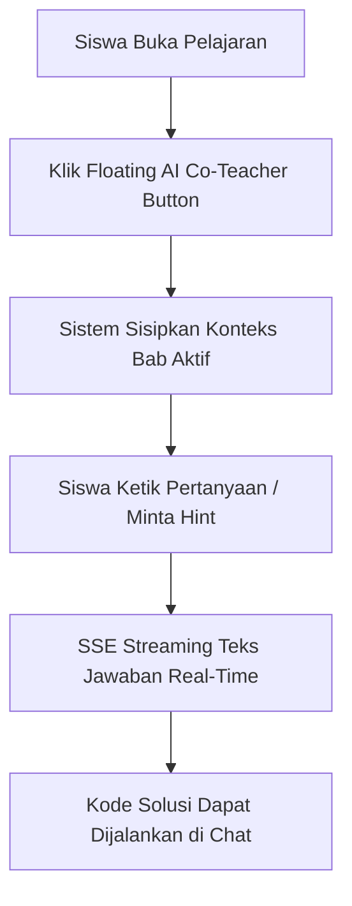

# 🧠 Sistem AI Co-Teacher & Asisten Belajar (LangServe & Chatbot System)

Sistem mentor AI kontekstual yang terintegrasi di ruang baca siswa untuk menjawab pertanyaan konsep, menjelaskan blok kode, memberikan petunjuk bertahap (*progressive hints*), dan mengevaluasi hasil kuis secara *real-time*.

---

## 📌 Ringkasan & Nilai Inti

* **Fokus Pengalaman**: Konsultasi belajar interaktif tanpa meninggalkan teks pelajaran (*dockable floating panel*).
* **Nilai Pengguna**: Siswa tidak terjebak saat menemukan konsep koding sulit; asisten AI membimbing layaknya instruktur pribadi yang memahami konteks bab yang sedang dibaca.

---

## 🗺️ Pemetaan Rute (`/app`)

| Rute Halaman | Jenis Integrasi | Tanggung Jawab Utama |
| :--- | :---: | :--- |
| `app/(learn)/course/[slug]/learn/page.tsx` | Docked Side Drawer | Asisten belajar penuh dengan injeksi otomatis konten bab aktif. |
| `app/page.tsx` | Interactive Showcase Widget | Simulator langsung kemampuan AI Co-Teacher bagi pengunjung sebelum registrasi. |

---

## 🧱 Modul & Komponen Kunci (`/features/langserve`)

### Antarmuka Obrolan (`features/langserve/chatbot/`)
* **`ChatbotAssistant.tsx`**: Kontainer panel obrolan (tombol mengambang pemicu, panel percakapan, header status AI, dan area input teks).
* **`ChatMessage.tsx`**: Perender gelembung pesan siswa dan AI dengan format Markdown, formula matematika KaTeX, serta blok kode interaktif.
* **`chat-input-bar.tsx`**: Bilah input pertanyaan dengan tombol kirim dan tombol pembatalan streaming (*Abort*).

### State & Handler Hook (`features/langserve/chatbot/hooks/`)
* **`useChatbot.ts`**: Pengendali siklus hidup obrolan:
  * Inisialisasi thread sesi unik per kursus (`thread_id`).
  * Sinkronisasi percakapan ke `localStorage` (`maguru_chat_session_[course]`).
  * Injeksi pemisah visual sistem (*system divider*) saat siswa berpindah bab.
  * Penanganan pembatalan streaming via `AbortController`.
  * Deteksi posisi scroll (*smart auto-scroll*: berhenti memaksa scroll ke bawah jika siswa sedang membaca pesan di atas).

### Klien API & Streaming (`features/langserve/`)
* **`api.ts`**: Klien komunikasi berbasis Server-Sent Events (SSE) dengan generator stream asynchronous `ReadableStream`.
* **`types.ts`**: Skema tipe data pesan obrolan, status streaming, dan konteks bab pelajaran.

---

## ⚡ 5 Rantai Spesialisasi AI (AI Chains)

Sistem ini tidak hanya menyediakan obrolan umum, tetapi memiliki 5 jalur kecerdasan terarah:

1. **`streamChatbot` (Mentor Konsep Umum)**:
   Membahas pertanyaan siswa seputar materi yang sedang dibuka dengan gaya ramah bertema akademi fantasi.
2. **`streamExplainCode` (Bedah Kode Baris-per-Baris)**:
   Menganalisis sintaks kodingan, alur logika variabel, dan kompleksitas algoritma dari kode yang disorot siswa.
3. **`streamHint` (Petunjuk Bertahap)**:
   Memberikan petunjuk kecil tanpa langsung membuka jawaban final, melatih daya analisis dan problem-solving siswa.
4. **`streamQuizFeedback` (Evaluasi Hasil Kuis)**:
   Memberikan ulasan mendalam mengenai alasan mengapa jawaban pilihan ganda siswa salah atau benar.
5. **`streamGreeting` (Sambutan Personal)**:
   Menyapa siswa saat pertama kali membuka bab dengan ringkasan singkat target yang akan dipelajari.

---

## ⚡ Kapabilitas Unggulan

* **Injeksi Konteks Cerdas (*Smart Context Pruning*)**:
  Fungsi `truncateContent` secara otomatis memangkas teks bab materi menjadi batas aman token (~1000 karakter) sebelum dikirimkan ke model AI, menghemat konsumsi token tanpa kehilangan esensi konteks.
* **Memori Multi-Turn Terhubung LangGraph**:
  Percakapan menggunakan identitas `thread_id` persisten yang terhubung ke SQLite/Postgres checkpointer di backend AI, memastikan AI mengingat pertanyaan siswa sebelumnya.
* **Eksekutor Kode di dalam Chat**:
  Jika AI memberikan contoh kode perbaikan, siswa dapat langsung mengklik tombol **"Run Code"** di dalam gelembung obrolan untuk melihat hasil eksekusinya via Pyodide WebAssembly.
* **Penyelamat Baterai & Tab Visibilitas**:
  Streaming otomatis dijeda jika siswa berpindah tab browser (`document.hidden === true`) untuk mencegah pemborosan CPU dan daya perangkat.

---

## 🔄 Alur Penggunaan (User Flow)

---

## 🔗 Dependensi Terkait
* **LangServe Backend Service** (`NEXT_PUBLIC_LANGSERVE_URL`, default `localhost:8000`).
* **`lib/code-runner/runner.ts`**: Eksekusi in-browser kode dari AI.
* **`rehype-katex` & `remark-math`**: Render rumus ilmiah dalam percakapan AI.
