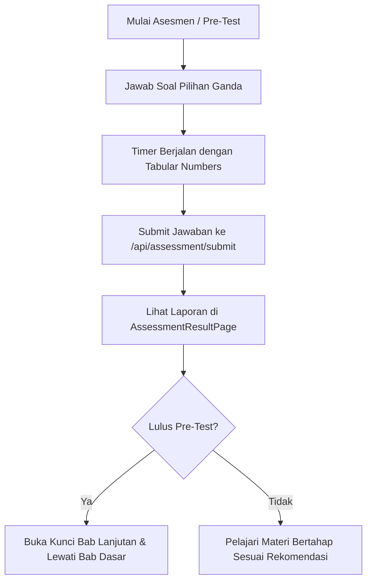

# 📝 Sistem Asesmen & Ujian Kompetensi (Diagnostic Assessment Engine)

Mesin pengujian kompetensi teknis untuk mengukur pemahaman siswa melalui pre-test penentu jalur belajar, kuis evaluasi per seksi, hingga ujian komprehensif akhir kursus.

---

## 📌 Ringkasan & Nilai Inti

* **Fokus Pengalaman**: Ujian interaktif dengan format soal teknis kaya (cuplikan kode dan rumus matematika) yang dilengkapi timer dan umpan balik analitik instan.
* **Nilai Pengguna**: Siswa yang sudah menguasai materi dasar dapat membuktikannya lewat *pre-test* untuk melompati bab pengantar (*skip learning*), menghemat waktu belajar.

---

## 🗺️ Pemetaan Rute (`/app`)

| Rute Halaman / Endpoint | Jenis Komponen | Tanggung Jawab Utama |
| :--- | :---: | :--- |
| `app/(learn)/course/[slug]/learn/page.tsx` | Mode Asesmen | Terpicu saat modul bertipe kuis dipilih di silabus belajar. |
| `/api/assessment/questions` | API Route (GET) | Mengambil daftar soal kuis, opsi jawaban teracak, dan batas waktu. |
| `/api/assessment/submit` | API Route (POST) | Mengevaluasi jawaban siswa, menghitung skor, dan menyimpan riwayat ujian. |
| `/api/assessment/results` | API Route (GET) | Mengambil riwayat skor dan status kelulusan kuis siswa. |
| `/api/assessment/reset` | API Route (POST) | Mengulang pengerjaan kuis untuk remedial. |

---

## 🧱 Modul & Komponen Kunci (`/features/assessment-engine`)

### Antarmuka Ujian & Hasil (`features/assessment-engine/components/`)
* **`AssessmentPage.tsx`**: Lembar kerja pengerjaan kuis interaktif yang memuat:
  * Indikator waktu hitung mundur (*countdown timer*).
  * Kisi navigasi nomor soal (menandai soal belum dijawab vs sudah dijawab).
  * Kartu pilihan ganda dengan status 5-state (Default, Selected, Correct, Incorrect, Disabled).
  * Tombol konfirmasi penyelesaian ujian (*Submit Assessment*).
* **`AssessmentResultPage.tsx`**: Halaman laporan hasil asesmen:
  * Skor akhir dan badge kelulusan.
  * Breakdown persentase penguasaan per topik (*Topic Mastery*).
  * Daftar bab yang berhasil dilewati (*skipped lessons*) berdasarkan hasil pre-test.
  * Tombol tinjau kunci jawaban dan pembahasan mendalam.
* **`RichQuestionContent.tsx`**: Perender pertanyaan teknis berdaya tinggi:
  * Tokenizer sintaks kodingan khusus tema Atelier Zero (highlight keyword, string, fungsi, komentar).
  * Formula matematika LaTeX via KaTeX.
  * Tombol salin kode pertanyaan.
* **`AssessmentErrorBoundary.tsx`**: Pelindung error terisolasi agar jika terjadi anomali pada salah satu soal, tata letak pembelajaran siswa tidak rusak total.

### State & Logika Bisnis (`features/assessment-engine/hooks/` & `schemas.ts`)
* **`useAssessment.ts`**: Hook pengelola pilihan jawaban aktif, timer hitung mundur, status loading submisi, dan alur perolehan hasil.
* **`schemas.ts`**: Skema validasi runtime Zod untuk struktur soal, opsi ganda, dan respons payload evaluasi.

---

## ⚡ Kapabilitas Unggulan

1. **Jalur Cepat Belajar (*Smart Pre-Test Adaptive Path*)**:
   Jika siswa lulus pre-test dengan skor tinggi pada topik tertentu, sistem secara cerdas membuka bab berikutnya dan menandai bab dasar sebagai *completed/skipped*, memangkas redundansi materi bagi siswa berpengalaman.
2. **Keterbacaan Soal Teknis Tingkat Lanjut**:
   Soal pemrograman tidak ditampilkan sebagai teks mentah polos, melainkan di-highlight otomatis menggunakan palet warna Atelier Zero (Rust Terracotta, Raw Sienna, Spruce Olive) yang nyaman dibaca.
3. **Penyelamatan Status Jawaban (*Zero Accidental Submit*)**:
   Dilengkapi dialog konfirmasi jika siswa masih menyisakan soal kosong saat menekan tombol selesaikan ujian.
4. **Resistensi Pergeseran Tata Letak (*Zero-CLS Tabular Numbers*)**:
   Waktu hitung mundur ujian (`04:59`) dan nomor soal menggunakan kelas font `tabular-nums` untuk mencegah lonjakan pergeseran layout saat detik berkurang.

---

## 🔄 Alur Penggunaan (User Flow)

---

## 🔗 Dependensi Terkait
* **`zod`**: Validasi integritas struktur soal dan skor.
* **`katex`**: Render formula matematika teknis.
* **`features/cms/Context/student/LearnContext.tsx`**: Integrasi status unlock seksi bab selanjutnya.
