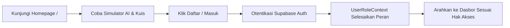

# 🔐 Sistem Autentikasi, Hak Akses & Portal Marketing (Auth, RBAC & Marketing Portal)

Sistem gerbang masuk aplikasi, autentikasi berbasis peran (*Role-Based Access Control*), pengamanan rute internal, dan portal marketing beranda publik bertema perkamen kuno.

---

## 📌 Ringkasan & Nilai Inti

* **Fokus Pengalaman**: Onboarding pengguna yang mulus, portal perkenalan produk yang interaktif tanpa batasan login, serta pembagian hak akses peran yang presisi.
* **Nilai Pengguna**: Pengunjung dapat langsung mencoba kemampuan AI Co-Teacher dan kuis mini di homepage sebelum mendaftar. Pengembang dapat beralih peran instan saat menguji fitur di mode development.

---

## 🗺️ Pemetaan Rute (`/app`)

| Rute Halaman | Jenis Rute | Tanggung Jawab Utama |
| :--- | :---: | :--- |
| `app/page.tsx` | Publik | Landing page utama Maguru (Hero showcase, simulator fitur, dan kurasi kursus). |
| `app/sign-in/page.tsx` | Publik | Formulir masuk akun via Supabase Auth. |
| `app/sign-up/page.tsx` | Publik | Formulir registrasi siswa atau calon kreator. |
| `app/unauthorized/page.tsx` | Proteksi | Halaman penolakan akses empatik jika pengguna mencoba membuka rute di luar perannya. |

---

## 🧱 Modul & Komponen Kunci (`/features/auth` & `/features/homepage`)

### Autentikasi & Otorisasi Peran (`features/auth/`)
* **`UserRoleContext.tsx`**: State provider terpusat untuk otentikasi peran:
  * Mendengarkan perubahan sesi *real-time* via `supabase.auth.onAuthStateChange`.
  * Mengekstraksi peran (`admin`, `creator`, `user`) dari metadata sesi akun.
  * Fitur alih peran pengembang (*Dev-Mode Role Switching*) tanpa perlu repot logout-login ulang.
* **`useUserRole.ts`**: Hook pengambil informasi peran pengguna, status otentikasi, dan hak akses rute.
* **`auth-middleware.ts` / `proxy.ts`**: Validasi hak akses rute server sebelum halaman dirender.

### Komponen Portal Beranda (`features/homepage/components/`)
* **`LandingPageNew.tsx`**: Struktur landing page lengkap:
  * **Hero Section**: Slogan utama bertema petualangan akademi teknologi perkamen kuno.
  * **Value Proposition**: Visualisasi perbandingan metode belajar teks vs video pasif.
  * **Curated Course Grid**: Pratinjau beberapa kartu kursus unggulan.
  * **Call to Action**: Tombol pendaftaran bermotif *deckle paper edge*.
* **`NavbarGlass.tsx`**: Bilah navigasi pill kaca mengambang (*floating glassmorphism navbar*) yang adaptif:
  * Menampilkan tombol Masuk/Daftar saat anonim.
  * Menampilkan menu peran (Dasbor Belajar, Buat Kursus, Admin) dan tombol keluar saat sudah masuk.
* **`AIChatbotSimulator.tsx`**: Simulator interaktif di homepage tempat calon pengguna dapat langsung menguji kepintaran AI Co-Teacher tanpa harus mendaftar terlebih dahulu.
* **`MicroAssessment.tsx`**: Simulator kuis interaktif singkat di homepage untuk merasakan pengalaman evaluasi diagnostik Maguru.
* **`EditorialSideRails.tsx`**: Aksen visual rel samping bergaya editorial majalah kuno.

---

## ⚡ Kapabilitas Unggulan

1. **Simulator Interaktif Pra-Registrasi**:
   Pengunjung tidak hanya membaca brosur teks; mereka dapat langsung berinteraksi dengan AI Co-Teacher dan kuis di homepage, mendongkrak konversi registrasi akun.
2. **Dev-Mode Role Switching Ramah Pengembang**:
   Di lingkungan `development`, pengembang dapat mengklik pemilih peran instan di antarmuka untuk langsung menguji tampilan sebagai **Admin**, **Creator**, atau **Student** dalam hitungan detik.
3. **Navigasi Global Cerdas (*Adaptive NavbarGlass*)**:
   Komponen `NavbarGlass` melayang dengan background blur kaca, otomatis mendeteksi status rute aktif dan menyesuaikan tautan menu sesuai peran akun yang login.
4. **Proteksi Otorisasi 3-Tier**:
   Mencegah siswa mengakses rute `/creator` atau `/admin`, serta mengarahkan pengguna secara elegan ke `/unauthorized` bila terjadi pelanggaran izin.

---

## 🔄 Alur Penggunaan (User Flow)

---

## 🔗 Dependensi Terkait
* **`@supabase/ssr` & `@supabase/supabase-js`**: Otentikasi dan sesi aman berbasis token JWT.
* **`lib/supabase/client.ts`**: Inisialisasi klien browser Supabase.
* **`components/ui/`**: Tombol, dialog modal, dan dropdown menu pengguna.
