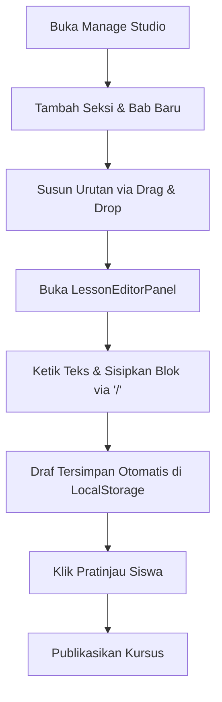

# ✍️ Sistem Manajemen Kursus & Studio Editor Kreator (Creator Course CMS)

Studio kurasi dan kepengarangan materi bagi instruktur untuk merancang kurikulum hierarkis, menyusun bab pelajaran dengan editor blok modern, serta mengelola status rilis materi secara terstruktur.

---

## 📌 Ringkasan & Nilai Inti

* **Fokus Pengalaman**: Penulisan materi intuitif layaknya Notion (*Slash Commands* & *Block-Based UI*) dengan kepastian tampilan akhir persis sama dengan yang dilihat siswa.
* **Nilai Pengguna**: Kreator dapat menyusun seksi pelajaran dengan cepat melalui drag-and-drop, menulis draf tanpa cemas kehilangan teks (*auto-save resilience*), dan memasukkan elemen interaktif (kode yang bisa dijalankan, callout, multi-kolom).

---

## 🗺️ Pemetaan Rute (`/app`)

| Rute Halaman | Jenis Komponen | Tanggung Jawab Utama |
| :--- | :---: | :--- |
| `app/creator/courses/page.tsx` | Client Island | Manajemen katalog kursus milik kreator (pencarian, filter status draf/publikasi, metrik siswa). |
| `app/creator/courses/create/page.tsx` | Client Island | Wizard pembentukan kursus baru (judul, deskripsi, slug, kategori, tingkat kesulitan). |
| `app/creator/courses/[slug]/manage/page.tsx` | Client Island | Ruang kerja (*workspace*) studio kurikulum: susunan seksi, editor materi, dan pratinjau. |
| `app/creator/profile/page.tsx` | Client Island | Editor profil pengajar, media sosial, riwayat pengalaman, dan portofolio keahlian. |

---

## 🧱 Modul & Komponen Kunci (`/features/cms`)

### Struktur Tata Letak Studio (`features/cms/components/creator/manage/`)
* **`ManageSidebar.tsx`**: Navigasi hierarki modul (Course Overview, Seksi, Bab Pelajaran, dan Kuis Evaluasi) dengan dukungan drag-and-drop.
* **`ManageHeader.tsx`**: Baris kendali atas memuat judul materi aktif, status simpan otomatis (*Saving/Saved*), tombol pratinjau siswa, dan tombol rilis kursus.
* **`ManageContent.tsx`**: Orkestrator panel utama yang menampilkan editor sesuai modul yang dipilih di sidebar.
* **`EditorToolbarStrip.tsx`**: Bilah alat cepat pemformatan teks di bagian atas area editor.

### Panel Kerja Spesifik (`features/cms/components/creator/manage/panels/`)
* **`LessonEditorPanel.tsx`**: Antarmuka editor utama memuat Tiptap dengan canvas perkamen Atelier Zero.
* **`LessonViewerPanel.tsx`**: Pratinjau langsung bab pelajaran dalam format bacaan siswa.
* **`CourseOverview.tsx`**: Pengaturan metadata utama kursus (thumbnail, ringkasan, harga/gratis).
* **`LearningOutcomesEditor.tsx`**: Kurasi daftar poin capaian kemampuan yang akan diperoleh siswa.
* **`QuizEditorPanel.tsx`**: Studio pembuatan soal kuis pilihan ganda, kunci jawaban, dan pembahasan.

### Ekstensi Tiptap Kustom (`features/cms/components/creator/manage/editor/extensions/`)
* **`SlashCommand.ts` & `SlashList.tsx`**: Menu popover yang muncul saat mengetik `/` untuk menyisipkan elemen heading, tabel, callout, atau blok kode.
* **`CustomCodeBlock.ts` & `CodeBlockComponent.tsx`**: Frame kode bernuansa Mac traffic lights Maguru dengan pilihan bahasa dan eksekutor in-browser.
* **`Callout.ts`**: Blok highlight informasi, tips bermanfaat, atau peringatan materi.
* **`Columns.ts`**: Tata letak konten multi-kolom berdampingan.
* **`PasteMarkdown.ts`**: Konverter otomatis teks Markdown clipboard menjadi node Tiptap saat pengguna melakukan *paste*.

### State & Handler Hook (`features/cms/hooks/manage/`)
* **`useCourseManage.ts`**: Pengendali data utama kursus, pemuatan seksi, dan mutasi rilis.
* **`useSectionHandlers.ts` & `useLessonHandlers.ts`**: Logika CRUD seksi materi dan bab pelajaran.
* **`useReorderHandlers.ts`**: Logika kalkulasi ulang indeks posisi bab saat dipindahkan via drag-and-drop.
* **`useLocalStorageDraft.ts`**: Sinkronisasi draf lokal di browser pengguna secara berkala (anti data-loss).
* **`useUnsavedChanges.ts`**: Peringatan konfirmasi jika pengguna hendak berpindah halaman sebelum perubahan disimpan.

---

## ⚡ Kapabilitas Unggulan

1. **Notion-Style Slash Menu (`/`)**:
   Kreator cukup mengetik garis miring (`/`) untuk memilih komponen blok yang ingin ditambahkan tanpa harus menjangkau toolbar atas.
2. **Reordering Halus dengan Dnd-Kit**:
   Penyusunan urutan seksi bab dapat digeser secara visual dengan drag-and-drop yang langsung memperbarui indeks urutan di backend.
3. **Pencadangan Draf Lokal Tangguh**:
   Setiap perubahan pada editor Tiptap otomatis dicadangkan ke `localStorage`. Jika browser tidak sengaja tertutup, modal pemulihan draf akan muncul saat halaman dibuka kembali.
4. **WYSIWYG 100% Konsisten**:
   Materi yang ditulis di `LessonEditorPanel` menggunakan styling tipografi, font Poppins & Fira Code, serta token batas warna yang sama persis dengan `LessonViewer` siswa.

---

## 🔄 Alur Penggunaan (User Flow)

---

## 🔗 Dependensi Terkait
* **`@tiptap/core` & `@tiptap/react`**: Fondasi headless rich text editor.
* **`@dnd-kit/core` & `@dnd-kit/sortable`**: Interaksi drag-and-drop silabus.
* **`/api/courses/[slug]/sections` & `/api/lessons`**: Penyimpanan struktur kurikulum ke basis data PostgreSQL via Prisma.
