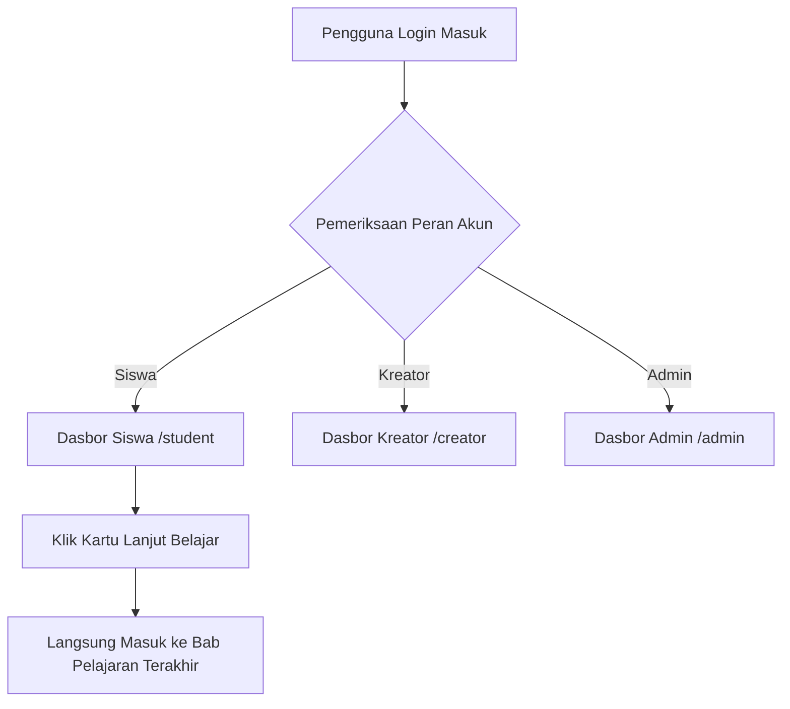

# 📊 Sistem Dasbor Peran & Analitik (Role-Based Dashboards & Analytics)

Pusat kendali dan observabilitas pengguna untuk memantau rutinitas progres belajar (siswa), analitik performa kursus dan siswa (kreator), serta metrik operasional platform (admin).

---

## 📌 Ringkasan & Nilai Inti

* **Fokus Pengalaman**: Beranda personalisasi berbasis kartu metrik terpadu yang memicu retensi belajar siswa dan produktivitas instruktur.
* **Nilai Pengguna**: Siswa dapat langsung melanjutkan materi terakhir hanya dengan 1-klik (*frictionless resume*), sementara pengajar mengetahui materi mana yang perlu diperbarui dan bagaimana performa pendaftaran kursusnya.

---

## 🗺️ Pemetaan Rute (`/app`)

| Rute Halaman | Hak Akses | Tanggung Jawab Utama |
| :--- | :---: | :--- |
| `app/dashboard/page.tsx` | Universal Auth | Router pengarah otomatis: mengalihkan pengguna ke dasbor peran masing-masing. |
| `app/student/page.tsx` | Student Role | Dasbor belajar siswa (target harian, streak belajar, kursus aktif, perolehan XP). |
| `app/creator/page.tsx` | Creator Role | Dasbor analitik kreator (kursus terbit, total siswa, rating, tindakan yang perlu diambil). |
| `app/admin/page.tsx` | Admin Role | Dasbor monitoring platform (total kursus, moderasi konten, audit peran pengguna). |

---

## 🧱 Modul & Komponen Kunci (`/features/creator-dashboard`, `user-dashboard`, `dashboard`)

### Dasbor Kreator (`features/creator-dashboard/components/`)
* **`CreatorHeader.tsx`**: Header sapaan instruktur dengan pintasan cepat membuat kursus baru.
* **`CourseOverviewCard.tsx`**: Rangkuman kartu metrik: total kursus aktif, siswa terdaftar, dan estimasi waktu penyelesaian rata-rata.
* **`ActionRequiredCard.tsx`**: Pengingat tugas mendesak pengajar (misal: draf modul belum tuntas, ulasan siswa yang belum dibalas).
* **`ContinueCreatingCard.tsx`**: Pintasan satu-klik untuk langsung kembali ke workspace edit kursus yang terakhir kali diubah.
* **`LearnerInsightsCard.tsx`**: Grafik analitik tingkat kesulitan materi berdasarkan topik yang paling sering gagal dijawab siswa.
* **`LibraryCourseCard.tsx` & `LibraryControls.tsx`**: Daftar kartu pustaka kursus milik kreator dengan filter status (Draft/Published) dan opsi pencarian.

### Dasbor Siswa (`features/user-dashboard/components/` & `features/dashboard/components/`)
* **`ContinueLearningCard.tsx`**: Kartu hero yang menampilkan materi bab terakhir yang belum tuntas dengan tombol aksi instan **"Lanjut Belajar"**.
* **`TodaysGoalCard.tsx`**: Target capaian belajar harian siswa (misal: "Selesaikan 2 Bab Hari Ini").
* **`LearningStreakCard.tsx`**: Pelacak kebiasaan belajar berturut-turut (*Daily Streak counter*) untuk memotivasi kedisiplinan belajar.
* **`LearningProgressCard.tsx`**: Diagram lingkaran dan bar persentase ketuntasan di seluruh kursus yang diikuti.
* **`RecommendedLearning.tsx`**: Rekomendasi kursus baru berdasarkan riwayat topik yang telah diselesaikan siswa.
* **`StatsGrid.tsx` & `StatsGrid.skeleton.tsx`**: Grid ringkasan metrik statistik dengan fallback skeleton anti layout shift.

---

## ⚡ Kapabilitas Unggulan

1. **Pengalihan Peran Otomatis (*Smart Role Dispatcher*)**:
   Membuka rute `/dashboard` tidak menampilkan halaman kosong, melainkan langsung mengevaluasi peran aktif akun via `UserRoleContext` dan mengarahkannya ke `/creator`, `/student`, atau `/admin`.
2. **Resistensi Pergeseran Tata Letak (*Zero-CLS Skeleton Wireframes*)**:
   Setiap kartu metrik memiliki berkas skeleton loader padanan (misal: `DashboardHeader.skeleton.tsx`, `RecentCourses.skeleton.tsx`) dengan ukuran identik, menjaga kestabilan visual saat data sedang dimuat dari server.
3. **Pemicu Retensi Pembelajaran Taktil**:
   Kartu *Daily Streak* dan kartu *Lanjut Belajar* menggunakan aksen warna Solar Orange (`#FFB148`) dan Action Red (`#FF4D4D`) dengan feedback sentuh taktil (`active:scale-[0.98]`).

---

## 🔄 Alur Penggunaan (User Flow)

---

## 🔗 Dependensi Terkait
* **`recharts`**: Visualisasi analitik grafik pendaftaran dan progres siswa.
* **`features/auth/hooks/useUserRole.ts`**: Verifikasi peran pengguna.
* **`app/api/creator/profile` & `app/api/progress`**: Penyedia data ringkasan dasbor.
