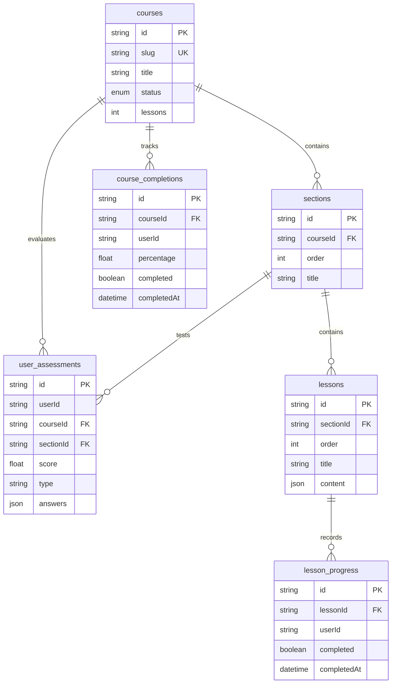

# 📋 Spesifikasi Kontrak API & Skema Data Pembelajaran Siswa

Dokumen ini mendokumentasikan secara rinci seluruh kontrak rute API (API Routes), tipe data request & response, skema entitas database (Prisma & Supabase), serta matriks penanganan error untuk modul **Sistem Pembelajaran Siswa (Student Learning)**.

---

## 1. Ringkasan Endpoint API

| Metode | Rute Endpoint | Akses / Autentikasi | Kegunaan Utama |
| :--- | :--- | :--- | :--- |
| **GET** | `/api/courses/[slug]/sections` | Publik / Siswa | Mengambil daftar seksi & pelajaran, mengecek kuis Pre-Test, dan status kunci seksi (`isLocked`). |
| **GET** | `/api/courses/[slug]/sections/[sectionId]/lessons/[lessonId]` | Terotentikasi / Publik Terdaftar | Mengambil konten lengkap materi Tiptap ProseMirror JSON. |
| **GET** | `/api/progress/course/[slug]` | Siswa Terotentikasi | Mengambil persentase total kemajuan kursus dan jumlah materi terselesaikan. |
| **GET** | `/api/progress/course/[slug]/lessons` | Siswa Terotentikasi / Guest Safe | Mengambil daftar ID materi yang telah diselesaikan oleh siswa dalam kursus. |
| **POST** | `/api/progress/lesson/[lessonId]/complete` | Siswa Terotentikasi | Menandai materi selesai, mengkalkulasi ulang persentase kursus secara atomik. |
| **GET** | `/api/assessment/results?courseId=[slug]` | Siswa Terotentikasi | Mengambil riwayat skor kuis dan rekomendasi pelajaran yang dilewati. |
| **POST** | `/api/assessment/reset?courseId=[slug]&sectionId=[id]` | Siswa Terotentikasi | Mereset percobaan kuis seksi untuk memungkinkan pengerjaan ulang (*retake*). |

---

## 2. Rincian Kontrak Endpoint

### 2.1 `GET /api/courses/[slug]/sections`

Mengambil struktur silabus kursus beserta status adaptif gating bagi siswa.

- **Query Parameters**:
  - `include=lessons` *(string, optional)*: Jika diset `lessons`, menyertakan daftar pelajaran untuk setiap seksi.
  - `role=student` *(string, optional)*: Mengaktifkan mode kalkulasi gating kuis untuk siswa.
- **Headers**:
  - `Cookie`: Cookie sesi Supabase (opsional, jika ada akan mengecek progres kuis).

#### Response Payload (200 OK)
```typescript
interface GetSectionsResponse {
  sections: Array<{
    id: string
    courseId: string
    title: string
    description?: string | null
    order: number
    lessonCount: number
    isLocked: boolean // true jika seksi sebelumnya belum lulus kuis (skor < 70%)
    lessons?: Array<{
      id: string
      title: string
      order: number
      contentPreview: string
    }>
  }>
  preTestCompleted: boolean // false jika siswa wajib mengambil tes awal sebelum membuka materi
  preTestScore: number | null // skor evaluasi awal (0 - 100)
}
```

#### Contoh Respons JSON
```json
{
  "sections": [
    {
      "id": "sec_01",
      "courseId": "crs_python_101",
      "title": "Pengenalan Python",
      "order": 1,
      "lessonCount": 3,
      "isLocked": false,
      "lessons": [
        { "id": "les_01", "title": "Instalasi dan Setup", "order": 1, "contentPreview": "Persiapan lingkungan..." },
        { "id": "les_02", "title": "Sintaks Dasar", "order": 2, "contentPreview": "Mengenal indentasi..." }
      ]
    },
    {
      "id": "sec_02",
      "courseId": "crs_python_101",
      "title": "Struktur Kontrol & Looping",
      "order": 2,
      "lessonCount": 4,
      "isLocked": true,
      "lessons": [
        { "id": "les_03", "title": "Percabangan If-Else", "order": 1, "contentPreview": "Logika kondisional..." }
      ]
    }
  ],
  "preTestCompleted": true,
  "preTestScore": 85.5
}
```

---

### 2.2 `GET /api/courses/[slug]/sections/[sectionId]/lessons/[lessonId]`

Mengambil dokumen materi lengkap untuk di-render oleh viewer Tiptap siswa.

- **Path Parameters**:
  - `slug`: Slug pengenal kursus.
  - `sectionId`: ID unik seksi.
  - `lessonId`: ID unik pelajaran.
- **Query Parameters**:
  - `role=student` *(string, optional)*: Memastikan data yang dikembalikan diformat untuk pembaca.

#### Response Payload (200 OK)
```typescript
interface FullLessonResponse {
  id: string
  sectionId: string
  title: string
  order: number
  content: {
    content: {
      type: 'doc'
      content: Array<Record<string, unknown>> // Pohon AST Tiptap ProseMirror
    }
    version: number
    lastEdit: string
  }
}
```

#### Contoh Respons JSON
```json
{
  "id": "les_01",
  "sectionId": "sec_01",
  "title": "Instalasi dan Setup",
  "order": 1,
  "content": {
    "version": 1,
    "lastEdit": "2026-10-15T10:00:00.000Z",
    "content": {
      "type": "doc",
      "content": [
        {
          "type": "heading",
          "attrs": { "level": 2 },
          "content": [{ "type": "text", "text": "Selamat Datang di Pembelajaran Python" }]
        },
        {
          "type": "customCodeBlock",
          "attrs": { "language": "python" },
          "content": [{ "type": "text", "text": "print('Halo Maguru!')" }]
        }
      ]
    }
  }
}
```

---

### 2.3 `GET /api/progress/course/[slug]`

Mengambil agregasi kemajuan penyelesaian kursus untuk pengguna saat ini.

- **Autentikasi**: Wajib (Supabase Auth).

#### Response Payload (200 OK)
```typescript
interface CourseProgressResponse {
  courseId: string
  completed: boolean
  percentage: number // Contoh: 45.5 (0 - 100)
  completedLessons: number
  totalLessons: number
  updatedAt: string
}
```

---

### 2.4 `GET /api/progress/course/[slug]/lessons`

Mengambil seluruh daftar ID materi yang berstatus selesai oleh siswa.

- **Autentikasi**: Guarded timeout 2000ms (Fallback ke `{ completedLessonIds: [] }` jika guest).

#### Response Payload (200 OK)
```typescript
interface CompletedLessonsResponse {
  completedLessonIds: string[]
}
```

#### Contoh Respons JSON
```json
{
  "completedLessonIds": [
    "les_01",
    "les_02"
  ]
}
```

---

### 2.5 `POST /api/progress/lesson/[lessonId]/complete`

Menandai materi telah selesai dipelajari secara persisten di database.

- **Autentikasi**: Wajib (Supabase Auth).
- **Body**: Kosong `{}`.

#### Response Payload (200 OK)
```typescript
interface MarkLessonCompleteResponse {
  id: string
  lessonId: string
  userId: string
  completed: boolean
  completedAt: string | null
  createdAt: string
}
```

#### Contoh Respons JSON
```json
{
  "id": "lp_99182a",
  "lessonId": "les_01",
  "userId": "usr_student_123",
  "completed": true,
  "completedAt": "2026-10-22T06:40:00.000Z",
  "createdAt": "2026-10-22T06:40:00.000Z"
}
```

---

### 2.6 `GET /api/assessment/questions`

Mengambil daftar pertanyaan kuis (Pre-Test atau Section Quiz) lengkap dengan kontrol batas percobaan (*attempt tracking*) dan deteksi masa jeda (*cooldown guard*).

- **Query Parameters**:
  - `courseId` *(string, required)*: ID atau slug kursus.
  - `sectionId` *(string, optional)*: ID unik seksi jika mengambil kuis seksi (jika absen = Pre-Test).
  - `allowRetake` *(boolean, optional)*: Jika diset `true`, mengizinkan pengambilan soal kembali bagi siswa yang sudah pernah lulus untuk meningkatkan nilai.
- **Autentikasi**: Wajib (Supabase Auth).

#### Response Payload (200 OK)
```typescript
interface GetAssessmentQuestionsResponse {
  questions: Array<{
    id: string
    question: string
    options: Record<string, string> // { a: "...", b: "...", c: "...", d: "..." }
    topic: string
    difficulty: 'easy' | 'medium' | 'hard'
  }>
  attempt: number // Percobaan ke berapa (1 atau 2)
  maxAttempts: number // Batas percobaan berturut-turut (default: 2)
  previousScore?: number // Skor percobaan sebelumnya jika ada
}
```

#### Response Payload (429 Too Many Requests - Cooldown Aktif)
```typescript
interface CooldownActiveResponse {
  error: 'COOLDOWN_ACTIVE'
  message: string
  cooldownRemainingSeconds: number // Sisa detik menuju berakhirnya 1 jam
  attempts: number // Jumlah percobaan tercatat (2)
  maxAttempts: number // 2
  score: number // Nilai tertinggi yang pernah diraih
}
```

#### Response Payload (409 Conflict - Sudah Selesai)
```typescript
interface AlreadyCompletedResponse {
  error: 'ALREADY_COMPLETED'
  passed: boolean
  score: number
  message: string
}
```

---

### 2.7 `POST /api/assessment/submit`

Mengirimkan jawaban evaluasi siswa, menghitung skor secara atomik, menerapkan kebijakan retensi nilai tertinggi (*Best Score Preservation*), dan membuka seksi berikutnya jika skor $\ge 70\%$.

- **Autentikasi**: Wajib (Supabase Auth).
- **Body**:
```typescript
interface SubmitAssessmentPayload {
  courseId: string
  sectionId?: string | null
  answers: Record<string, string> // { [questionId]: "a" }
  durationSeconds?: number | null
}
```

#### Response Payload (200 OK)
```typescript
interface SubmitAssessmentResponse {
  overallScore: number // Skor murni percobaan ini (0 - 100)
  bestScore: number // Skor tertinggi yang disimpan (Best Score Preservation)
  topicScores: Record<string, number>
  totalQuestions: number
  correctCount: number
  wrongCount: number
  topicDetails: Record<string, { correct: number; total: number; percentage: number }>
  skippedLessonIds: string[] // Pelajaran yang dilewati (khusus Pre-Test)
  unlockedNextSection: boolean // true jika bestScore >= 70%
  attempt: number // Percobaan ke berapa yang baru diselesaikan (1 atau 2)
  maxAttempts: number // 2
  isCooldownTriggered: boolean // true jika gagal pada percobaan ke-2 (memicu jeda 1 jam)
}
```

---

### 2.8 `POST /api/assessment/reset`

Mereset data percobaan kuis seksi untuk memungkinkan pengerjaan ulang (*clean retry*), dengan perlindungan *cooldown guard* agar batas 1 jam tidak dapat di-bypass.

- **Query Parameters**:
  - `courseId` *(string, required)*: ID atau slug kursus.
  - `sectionId` *(string, optional)*: ID seksi yang ingin diatur ulang.
- **Autentikasi**: Wajib (Supabase Auth).

#### Response Payload (200 OK)
```typescript
interface ResetAssessmentResponse {
  success: boolean
  count: number // Jumlah rekaman yang dihapus
}
```

#### Response Payload (429 Too Many Requests - Cooldown Guard)
Jika siswa mencoba memanggil reset saat masa cooldown 1 jam masih aktif:
```typescript
{
  "error": "COOLDOWN_ACTIVE",
  "message": "Batas 2x percobaan tercapai. Silakan pelajari materi kembali sebelum mencoba lagi.",
  "cooldownRemainingSeconds": 2400
}
```

---

## 3. Skema Data Terkait (Prisma & Supabase)

Entitas database utama yang dikonsumsi oleh fitur pembelajaran siswa:



### 3.1 Model Prisma Relevan

```prisma
model courses {
  id          String        @id
  slug        String        @unique @db.VarChar(150)
  title       String        @db.VarChar(100)
  status      CourseStatus  @default(DRAFT)
  lessons     Int           @default(0)
  sections    sections[]
  user_assessments user_assessments[]
}

model sections {
  id          String        @id
  courseId    String
  order       Int
  title       String        @db.VarChar(200)
  lessons     lessons[]
  courses     courses       @relation(fields: [courseId], references: [id], onDelete: Cascade)
  user_assessments user_assessments[]
  @@unique([courseId, order])
}

model lessons {
  id              String            @id
  sectionId       String
  order           Int
  title           String            @db.VarChar(200)
  content         Json              // Tiptap ProseMirror document AST
  sections        sections          @relation(fields: [sectionId], references: [id], onDelete: Cascade)
  lesson_progress lesson_progress[]
  @@unique([sectionId, order])
}

model lesson_progress {
  id          String    @id
  lessonId    String
  userId      String    @db.VarChar(255)
  completed   Boolean   @default(false)
  completedAt DateTime?
  lessons     lessons   @relation(fields: [lessonId], references: [id], onDelete: Cascade)
  @@unique([lessonId, userId])
}

model course_completions {
  id          String    @id
  courseId    String
  userId      String    @db.VarChar(255)
  percentage  Float     @default(0)
  completed   Boolean   @default(false)
  completedAt DateTime?
  @@unique([courseId, userId])
}

model user_assessments {
  id              String    @id @default(cuid())
  userId          String    @db.VarChar(255)
  courseId        String    @db.VarChar(255)
  sectionId       String?   @db.VarChar(255) // Null jika kuis PRE_TEST
  score           Float     // 0.0 - 100.0 (Best Score Preservation)
  type            String    @default("PRE_TEST") @db.VarChar(20) // PRE_TEST | SECTION_QUIZ
  answers         Json      // { [questionId]: "a", _metadata: { attempts: 1|2, lastAttemptAt: ISO, highestScore: number } }
  durationSeconds Int?      // Durasi kuis dalam detik
  completedAt     DateTime  @default(now())
  @@unique([userId, courseId, sectionId, type])
}
```

---

## 4. Matriks Status HTTP & Kode Kesalahan

Format respons error standar:
```typescript
interface ApiErrorResponse {
  error: string
  code: 'UNAUTHORIZED' | 'FORBIDDEN' | 'NOT_FOUND' | 'COOLDOWN_ACTIVE' | 'ALREADY_COMPLETED' | 'VALIDATION_ERROR' | 'INTERNAL_ERROR'
  details?: Record<string, unknown>
}
```

| Status Code | Error Code | Skenario Pemicu | Penanganan Frontend |
| :--- | :--- | :--- | :--- |
| **401 Unauthorized** | `UNAUTHORIZED` | Token sesi Supabase kedaluwarsa atau pengguna belum login saat menandai materi selesai. | Rollback state optimis, munculkan toast Sonner: *"Sesi login telah berakhir. Silakan login kembali."* |
| **403 Forbidden** | `FORBIDDEN` | Pengguna mencoba mengakses materi kursus dalam status `DRAFT` tanpa hak milik creator/admin. | Tampilkan layar peringatan izin akses terbatas. |
| **404 Not Found** | `NOT_FOUND` | `slug` kursus, `sectionId`, atau `lessonId` tidak ditemukan di database. | Tampilkan card error `Materi tidak ditemukan` + tombol kembali ke katalog. |
| **409 Conflict** | `ALREADY_COMPLETED` | Kuis Pre-Test sudah diselesaikan atau kuis seksi telah lulus ($\ge 70\%$) tanpa flag `allowRetake`. | Tampilkan kartu hasil kelulusan bab dengan opsi: *"Ulangi Kuis untuk Tingkatkan Nilai"* atau *"Lanjut Belajar"*. |
| **429 Too Many Requests** | `COOLDOWN_ACTIVE` | Siswa gagal ($\text{skor} < 70\%$) setelah 2x percobaan berurutan pada kuis seksi dalam rentang 1 jam. | Tampilkan antarmuka ramah **Layar Cooldown (Jeda Belajar)** lengkap dengan indikator sisa waktu `⏱️ ~X Menit` dan saran membaca ulang materi. |
| **500 Internal Error** | `INTERNAL_ERROR` | Kesalahan koneksi basis data atau kegagalan transaksi Prisma. | Rollback state lokal dan tampilkan notifikasi Sonner `toast.error(message)`. |

---

> Dokumen terkait:
> - Penjelasan alur sistem, diagram sequence & activity: [Alur Sistem Pembelajaran Siswa](file:///d:/.maguru/maguru/docs/feature/student-learning/system-flow.md)
> - Ringkasan fitur & indeks: [Indeks Pembelajaran Siswa](file:///d:/.maguru/maguru/docs/feature/student-learning/readme.md)
