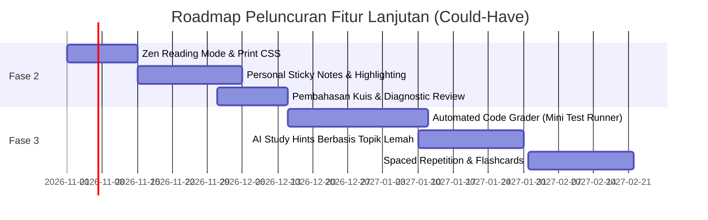

# 🚀 Rencana Peningkatan Sistem (Future Improvements & Could-Have Backlog)

Dokumen ini mendokumentasikan spesifikasi usulan fitur untuk fase pengembangan lanjutan (*Could-Have / Future Phases*) pada modul **Sistem Pembelajaran Siswa (Student Learning Experience & Course Reader)** di Maguru.

---

## 1. Matriks Rencana Peningkatan

| Inisiatif Fitur | Kategori / Tipe | Kompleksitas Teknis | Nilai Tambah Pengguna |
| :--- | :--- | :---: | :--- |
| **Personal Sticky Notes & Highlight** | Catatan Belajar | Sedang | Siswa dapat menandai kalimat penting dan menyimpan intisari materi di laci buku catatan pribadi (*Notebook Drawer*). |
| **Automated Code Grader (Test Runner)** | Evaluasi Praktikum | Tinggi | Mengubah blok kode playground menjadi latihan interaktif dengan verifikasi otomatis terhadap *test cases*. |
| **Zen Reading Mode (Focus Immersion)** | Ergonomi Visual | Rendah | Mode layar penuh tanpa gangguan yang menyembunyikan sidebar silabus dan floating widgets. |
| **Ekspor PDF & Offline Reader** | Aksesibilitas | Sedang | Mengunduh materi bab ke dalam dokumen PDF perkamen rapi untuk dipelajari saat offline. |
| **Spaced Repetition / Flashcards Mini** | Retensi Memori | Sedang | Kuis kilas interaktif di akhir materi untuk memperkuat ingatan konsep teknis sebelum kuis seksi. |

---

## 2. Rincian Arsitektur Fitur Lanjutan

### 2.1 Personal Sticky Notes & Text Highlighting

#### Konsep & Nilai UX
Siswa yang sedang membaca materi teknis seringkali ingin menandai istilah kunci, mendokumentasikan pemahaman pribadi, atau menulis pengingat (*reminder*).

#### Usulan Skema Database (Prisma)
```prisma
model lesson_notes {
  id           String   @id @default(cuid())
  userId       String   @db.VarChar(255)
  lessonId     String   @db.VarChar(255)
  selectedText String   @db.Text
  noteContent  String   @db.Text
  colorTheme   String   @default("mustard") @db.VarChar(20) // mustard | coral | olive
  positionNode Json?    // Tiptap selection from/to offsets
  createdAt    DateTime @default(now())
  updatedAt    DateTime @updatedAt

  lessons      lessons  @relation(fields: [lessonId], references: [id], onDelete: Cascade)

  @@index([userId, lessonId])
}
```

#### Alur Komponen Antarmuka
1. Pengguna menyeleksi teks di dalam `<LessonViewer />`.
2. Muncul tooltip menu mengambang (*Bubble Menu* Tiptap) dengan opsi: **"Sorot Teks"** dan **"Buat Catatan"**.
3. Catatan tersimpan dapat diakses melalui drawer samping kanan (*Student Notebook Panel*).

---

### 2.2 Automated Code Grader (In-Browser Test Runner)

#### Konsep & Nilai UX
Meningkatkan blok kode dari sekadar *code runner* bebas menjadi *interactive challenge* (seperti LeetCode / Codecademy mini).

#### Format Definisi Soal pada Konten Materi
```json
{
  "type": "codingExercise",
  "attrs": {
    "language": "python",
    "starterCode": "def jumlahkan(a, b):\n    # Tulis kodemu di sini\n    pass",
    "testCases": [
      { "input": "jumlahkan(2, 3)", "expected": "5", "hidden": false },
      { "input": "jumlahkan(-1, 1)", "expected": "0", "hidden": false },
      { "input": "jumlahkan(100, 250)", "expected": "350", "hidden": true }
    ]
  }
}
```

#### Cara Kerja Engine Verifikasi
1. Kode siswa digabungkan dengan skrip harness pengujian di dalam `runner.ts`.
2. Pyodide WebAssembly mengeksekusi setiap test case secara lokal dalam memori browser.
3. Siswa menerima umpan balik seketika: `✅ 3/3 Test Cases Berhasil (18ms)` tanpa beban server backend.

---

### 2.3 Zen Reading Mode (Mode Fokus Penuh)

#### Konsep & Nilai UX
Memberikan pengalaman membaca seperti buku fisik (*immersion reading*) tanpa distraksi tombol silabus, navbar, atau widget floating.

#### Mekanisme Implementasi
- Tombol toggle di `LearnHeader` atau pintasan keyboard `Z`.
- State `isZenMode === true`:
  - Sidebar silabus runtuh (*collapsed* penuh ke 0px).
  - AI Co-Teacher floating button diminimalkan.
  - Lebar container `LessonViewer` secara otomatis memusat pada `max-w-3xl` dengan ukuran font yang sedikit dinaikkan untuk keterbacaan optimal.

---

### 2.4 Ekspor PDF Perkamen & Dukungan Offline

#### Konsep & Nilai UX
Siswa dapat mencetak atau mengunduh rangkuman materi lengkap satu bab dalam format PDF yang mempertahankan estetika *Atelier Zero* (font Manrope, background perkamen halus, dan format kode sintaks rapi).

#### Mekanisme Implementasi
- Menggunakan CSS print stylesheet `@media print`:
  ```css
  @media print {
    .sidebar, .floating-ai, .lesson-navigation { display: none !important; }
    .lesson-viewer { max-width: 100% !important; padding: 0 !important; }
  }
  ```
- Tombol aksi `window.print()` yang secara otomatis memicu preview cetak atau simpan ke PDF di peramban pengguna.

---

## 3. Prioritas Peluncuran Bertahap



---

## 4. Analisis MoSCoW Khusus Sistem Evaluasi & Pengulangan Kuis (Assessment Retake)

Sesuai aturan pedagogi dan proteksi anti-spam platform, sistem kuis memiliki kebijakan:
- **Batas Percobaan**: Maksimal 2x percobaan berurutan.
- **Jeda Cooldown**: Jika 2x berturut-turut masih belum mencapai skor $\ge 70\%$, siswa wajib menunggu jeda **1 jam (3600 detik)** sebelum dapat mencoba kuis kembali.
- **Best Score Preservation**: Nilai tertinggi siswa selalu dipertahankan.

Berikut adalah pemilahan tegas antara prioritas **Could Have** (fase lanjut) dan **Won't Have** (ditolak/di luar lingkup):

### 4.1 Prioritas Could Have (Peluang Peningkatan Fase Lanjut)

| Inisiatif Could Have | Nilai Pedagogis & UX | Kompleksitas Teknis | Rencana Penerapan |
| :--- | :--- | :---: | :--- |
| **1. Diagnostic Review (Pembahasan Soal Salah)** | Menampilkan kunci jawaban dan penjelasan konseptual khusus untuk soal yang dijawab salah sebelum siswa mengambil kuis ulang. | Sedang | Membuka drawer tinjauan jawaban setelah submit kuis selesai. |
| **2. AI Study Hints Berbasis Topik Lemah** | Widget AI Co-Teacher secara otomatis menganalisis topik dengan skor rendah dan memberikan rangkuman materi ringkas ke siswa selama masa cooldown. | Sedang | Integrasi endpoint analisis hasil kuis ke modul LangServe. |
| **3. Riwayat Tren Nilai Kuis (*Score Progression Chart*)** | Grafik progres kecil yang menunjukkan perbandingan skor percobaan 1 vs percobaan 2 vs nilai terbaik. | Rendah | Menggunakan komponen SVG progress sparkline di `AssessmentResultPage`. |
| **4. Notifikasi Email Pengingat Selesai Cooldown** | Mengirimkan notifikasi ramah ke email siswa saat 1 jam masa jeda berakhir agar siswa kembali melanjutkan belajarnya. | Sedang | Supabase Edge Function / Scheduled Cron job. |

### 4.2 Prioritas Won't Have (Secara Tegas Ditolak / Di Luar Lingkup)

| Kebijakan / Fitur | Alasan Penolakan (Arsitektur & Nilai Filosofis) |
| :--- | :--- |
| **1. Batas Keras Permanen (*Permanent Failure Lockout*)** | **DITOLAK**. Maguru memegang prinsip *Mastery Learning* (pembelajaran tuntas). Siswa tidak boleh dibatasi secara mutlak (misal: gagal 3x lalu akun disuspend atau kursus hangus). Siswa harus selalu memiliki kesempatan belajar dan mengulang setelah jeda refleksi (cooldown 1 jam). |
| **2. Monetisasi / Membayar untuk Mengulang Kuis (*Pay-to-Retake*)** | **DITOLAK**. Mengulang kuis adalah proses pedagogis murni, bukan mekanisme paywall. Semua siswa berhak mengulang kuis tanpa biaya tambahan. |
| **3. Bypass Cooldown Instan Tanpa Belajar** | **DITOLAK**. Tombol bypass atau skip cooldown dilarang keras karena tujuan jeda 1 jam adalah mendorong siswa membaca kembali materi bab, bukan melakukan *brute-force guessing*. |
| **4. Pengurangan Nilai Riwayat (*Score Penalty on Retake*)** | **DITOLAK**. Sistem tidak boleh memotong skor tertinggi jika nilai pada percobaan kedua lebih rendah dari percobaan pertama. Prinsip *Best Score Preservation* mutlak berlaku. |

