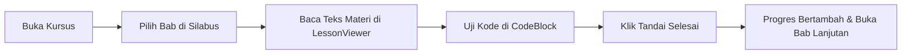

# 🎓 Sistem Pembelajaran Siswa (Student Learning Experience & Course Reader)

Sistem antarmuka utama tempat siswa mempelajari materi kursus teks teknis, menavigasi silabus bab terstruktur, mengeksekusi kode langsung di peramban, dan memantau persentase kelulusan belajar.

---

## 📌 Ringkasan & Nilai Inti

* **Fokus Pengalaman**: Membaca materi panjang (*reading-first ergonomics*) tanpa kelelahan visual di perangkat Tablet dan Desktop (≥ 768px).
* **Nilai Pengguna**: Siswa belajar konsep langkah demi langkah, melihat progres belajar yang tersimpan otomatis, dan langsung menguji contoh kode tanpa konfigurasi lokal (*zero-setup*).

> 📚 **Dokumentasi Teknis Lengkap:**
> - [🧭 Alur Orkestrasi Sistem & Diagram UML (`system-flow.md`)](file:///d:/.maguru/maguru/docs/feature/student-learning/system-flow.md)
> - [📋 Spesifikasi Kontrak Endpoint API & Skema Data (`api-contracts.md`)](file:///d:/.maguru/maguru/docs/feature/student-learning/api-contracts.md)
> - **Subsistem Internal (`subsystems/`):**
>   - [⚙️ In-Browser Code Runner Sandbox (`subsystems/code-runner.md`)](file:///d:/.maguru/maguru/docs/feature/student-learning/subsystems/code-runner.md)
>   - [📖 WYSIWYG Lesson Reader Engine (`subsystems/lesson-reader.md`)](file:///d:/.maguru/maguru/docs/feature/student-learning/subsystems/lesson-reader.md)
>   - [📊 Progress Tracking & Adaptive Gating (`subsystems/progress-gating.md`)](file:///d:/.maguru/maguru/docs/feature/student-learning/subsystems/progress-gating.md)
> - [🚀 Rencana Peningkatan Fase Lanjutan (Could-Have Backlog) (`improvement.md`)](file:///d:/.maguru/maguru/docs/feature/student-learning/improvement.md)

---

## 🗺️ Pemetaan Rute (`/app`)

| Rute Halaman | Jenis Komponen | Tanggung Jawab Utama |
| :--- | :---: | :--- |
| `app/(learn)/course/[slug]/learn/page.tsx` | Client Island | Ruang baca materi fokus penuh (*distraction-free layout* tanpa navbar global). |
| `app/course/page.tsx` | Server Component | Katalog pencarian, filter kategori, dan kartu preview seluruh kursus publik. |
| `app/course/[slug]/page.tsx` | Server Component | Halaman detail silabus, deskripsi instruktur, prasyarat, dan tombol pendaftaran (*enrollment*). |
| `app/student/courses/page.tsx` | Client Component | Daftar seluruh kursus yang sedang aktif diikuti oleh akun siswa. |

---

## 🧱 Modul & Komponen Kunci (`/features/cms`)

### Komponen UI Presentasional (`features/cms/components/student/`)
* **`LessonViewer.tsx`**: Renderer materi berbasis headless Tiptap dengan konfigurasi ekstensi identik ke versi editor pengajar (menjamin konsistensi WYSIWYG 100%).
* **`CourseNavigation.tsx`**: Panel drawer samping yang memuat daftar seksi, status bab (selesai, aktif, atau terkunci), dan tombol alih bab.
* **`ProgressBar.tsx`**: Indikator persentase kelulusan materi dengan angka tabular (`tabular-nums`) anti pergeseran tata letak.
* **`LessonNavigation.tsx`**: Baris tombol aksi navigasi bawah (*Sebelumnya*, *Tandai Selesai*, *Selanjutnya*).
* **`LearnHeader.tsx`**: Header navigasi ringkas memuat tombol kembali ke silabus, judul kursus, dan pemicu laci materi.

### State & Logika Bisnis (`features/cms/Context/student/` & `hooks/learn/`)
* **`LearnContext.tsx`**: React Context scoped penyedia status aktif bab, daftar seksi, dan cache data pelajaran.
* **`useCourseLearn.ts`**: Hook pengambil metadata kurikulum dari endpoint `/api/courses/[slug]`.
* **`useLessonLearn.ts`**: Hook pengambil isi materi bab aktif via `/api/lessons/[lessonId]`.
* **`useProgressHandlers.ts`**: Logika mutasi status selesai dan sinkronisasi ke tabel progres siswa.

---

## ⚡ Kapabilitas Unggulan

1. **Sinkronisasi Parameter URL Dua Arah**:
   Bab aktif selalu tercermin pada query URL `?lesson=[lessonId]`. Membuka tautan langsung atau menekan tombol *refresh* browser akan mempertahankan posisi belajar siswa tanpa reset ke bab awal.
2. **Eksekusi Kode di Tempat (*In-Browser Code Runner*)**:
   Blok kode di dalam teks materi terhubung dengan engine Pyodide WebAssembly (Python) dan Sandbox evaluasi (JavaScript). Siswa dapat menekan tombol **"Run Code"** untuk melihat output `stdout` pada laci terminal bawah.
3. **Kenyamanan Baca Standar Atelier Zero**:
   Teks dibatasi pada lebar `max-w-3xl` (65–75 karakter per baris) dengan `leading-relaxed` (1.65–1.75) pada latar belakang kertas perkamen halus `#FFFDF9`.
4. **Proteksi Layar Mobile Global**:
   Akses di bawah 768px dibatasi oleh `<MobileDeviceNotice />` untuk menjaga kualitas membaca tabel dan blok kode teknis.

---

## 🔄 Alur Penggunaan (User Flow)

---

## 🔗 Dependensi Terkait
* **`@tiptap/react`**: Perenderan teks kaya terstruktur.
* **`lib/code-runner/runner.ts`**: Engine WebAssembly eksekusi kode.
* **`/api/progress` & `/api/lessons`**: Penyimpanan status ketuntasan siswa.
