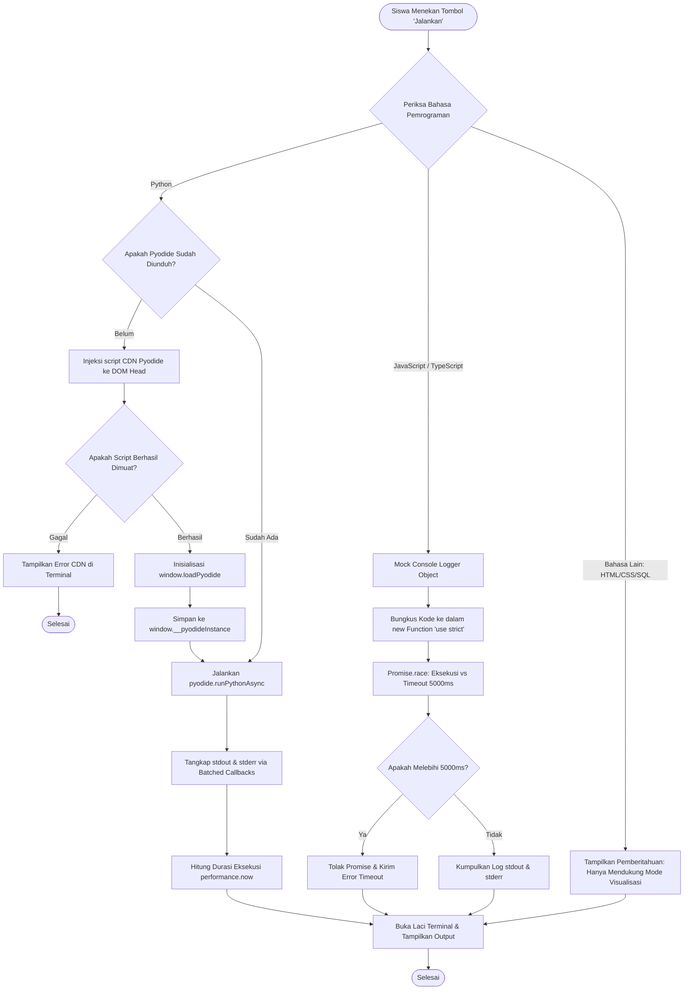
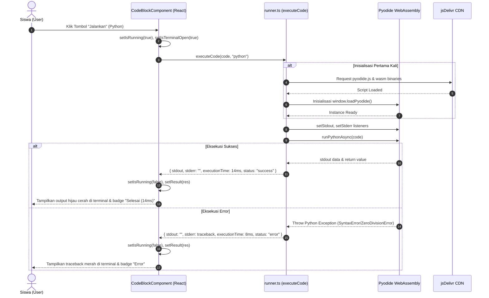

# ⚙️ Subsistem: In-Browser Code Runner Sandbox

Dokumen spesifikasi teknis mengenai engine eksekusi kode interaktif di sisi klien (*client-side in-browser sandbox*) untuk materi pemrograman teknis pada platform Maguru.

---

## 1. Topologi File & Tanggung Jawab Modul

```
maguru/
├── lib/code-runner/
│   └── runner.ts                                     # Engine WebAssembly (Pyodide) & JS Sandbox
└── features/cms/components/creator/manage/editor/
    ├── components/CodeBlockComponent.tsx             # NodeView UI (Terminal, tombol Run, language picker)
    └── extensions/CustomCodeBlock.ts                 # Ekstensi Tiptap mendaftarkan ReactNodeViewRenderer
```

- **`lib/code-runner/runner.ts`**: Pure TypeScript core runner. Bertanggung jawab terhadap injeksi script Pyodide CDN, inisialisasi singleton WebAssembly di objek `window`, pengalihan stream `stdout`/`stderr`, serta eksekusi sandbox JavaScript menggunakan `Function(...)` dengan batas waktu ketat (*timeout guard*).
- **`CodeBlockComponent.tsx`**: React NodeView component yang terhubung langsung ke pohon dokumen Tiptap ProseMirror. Menyediakan UI taktil bergaya *Atelier Zero*: lampu indikator warna Maguru (Coral, Mustard, Olive), pemilih bahasa, tombol "Jalankan", tombol salin kode, dan laci terminal lipat (*collapsible terminal drawer*).
- **`CustomCodeBlock.ts`**: Ekstensi Tiptap yang meng-extend `@tiptap/extension-code-block` default agar me-render `CodeBlockComponent` sebagai React Node View.

---

## 2. Arsitektur & Cara Kerja Internal

### 2.1 Eksekusi Python via WebAssembly (Pyodide v0.26.4)
1. **Lazy Loading Singleton**: Script Pyodide `https://cdn.jsdelivr.net/pyodide/v0.26.4/full/pyodide.js` dimuat hanya ketika siswa pertama kali menekan tombol **"Jalankan"** pada kode Python.
2. **Global Promise Cache**: Menggunakan `window.__pyodideLoadingPromise` untuk mencegah unduhan ganda jika terdapat beberapa blok kode yang dijalankan bersamaan.
3. **Stream Redirection**:
   - `pyodide.setStdout({ batched: (msg) => stdout += msg })`
   - `pyodide.setStderr({ batched: (msg) => stderr += msg })`
4. **Return Value Representation**: Jika kode berupa ekspresi tanpa `print()` (contoh: `2 + 5`), runner menangkap nilai balikan `pyodide.runPythonAsync(code)` dan menampilkannya sebagai output `stdout`.
5. **Keamanan & Efisiensi Biaya**: Kode dieksekusi 100% pada CPU browser pengguna melalui WebAssembly Sandbox. Server backend Maguru mengeluarkan biaya komputasi $0 dan terlindung mutlak dari serangan *Remote Code Execution* (RCE).

### 2.2 Eksekusi JavaScript / TypeScript Sandbox
1. **Isolated Function Scope**: Kode dieksekusi di dalam wrapper fungsi:
   ```typescript
   const executor = new Function('console', `"use strict";\n${code}`)
   ```
2. **Console Interceptor**: Variabel `console` lokal di-override dengan mock object yang menangkap seluruh argumen `log`, `info`, `warn` (prefix `[WARN]`), dan `error` (prefix `[ERROR]`). Nilai bertipe objek otomatis diserialisasi via `JSON.stringify(obj, null, 2)`.
3. **Protection against Infinite Loops (5000ms Timeout Guard)**:
   Menggunakan `Promise.race()` antara eksekusi fungsi dengan `setTimeout(5000)` untuk mencegah perulangan tak terbatas (`while(true)`) membuat tab browser siswa membeku (*hang*).

---

## 3. Keandalan, Error Handling & UX Feedback

| Potensi Kegagalan | Mekanisme Pertahanan | Tampilan / Umpan Balik Siswa |
| :--- | :--- | :--- |
| **Koneksi CDN jsDelivr Terblokir** | Try-catch pada injeksi `<script>` dengan `onerror` listener. | Pesan error jelas di terminal: `"Gagal memuat Pyodide dari CDN. Periksa koneksi internet."` |
| **Sintaks Error / Runtime Exception** | Tangkapan error via blok try-catch runner mengembalikan `status: 'error'`. | Kotak terminal otomatis terbuka menampilkan traceback merah dengan latar krem gelap. Badge status `Error` menyala. |
| **Infinite Loop pada JavaScript** | Balapan `Promise.race` dengan timeout 5000 milidetik. | Eksekusi dibatalkan paksa dan menampilkan pesan: `"Waktu eksekusi melebihi batas (Timeout 5000ms)"`. |
| **Status Menjalankan (Pending)** | State `isRunning === true` menonaktifkan tombol run (`disabled`). | Tombol berganti menjadi spinner animasi `Loader2` dengan label `"Menjalankan..."`. |
| **Salin Kode ke Clipboard** | Menggunakan `navigator.clipboard.writeText()` dengan timeout 2000ms. | Ikon tombol salin berganti menjadi centang hijau `Check` bertuliskan `"Tersalin"`. |

---

## 4. UML Activity Diagram: Eksekusi Kode di Browser



---

## 5. UML Sequence Diagram: Interaksi Komponen Runner



---

## 6. Audit Edge Cases & Rekomendasi Ketahanan Kode

1. **State Isolation pada Python**:
   - *Kondisi*: Pyodide mempertahankan variabel global antar eksekusi jika berada dalam tab yang sama (contoh: baris `x = 10` pada blok 1 akan terbaca pada blok 2 jika siswa mengeksekusinya).
   - *Rekomendasi Lanjutan*: Sediakan tombol *"Reset Environment"* yang memanggil `pyodide.runPython("globals().clear()")` untuk membersihkan namespace memori jika siswa ingin memulai kembali.
2. **Keterbatasan Eksekusi DOM / JSDOM**:
   - Runner JavaScript saat ini tidak mengekspos objek `document` atau `window` ke dalam `new Function` demi mencegah siswa memanipulasi DOM aplikasi Maguru secara tidak sengaja.
3. **Penyaringan Keyword Berbahaya**:
   - Walaupun JavaScript berjalan di sisi browser siswa sendiri, penggunaan `new Function` dapat dibatasi agar tidak dapat mengakses `window.localStorage` atau `document.cookie` dengan membungkus parameter lokal:
     ```typescript
     new Function('console', 'localStorage', 'sessionStorage', 'document', `"use strict";\n${code}`)
     ```
     dan meneruskan `undefined` untuk parameter keamanan tersebut.
