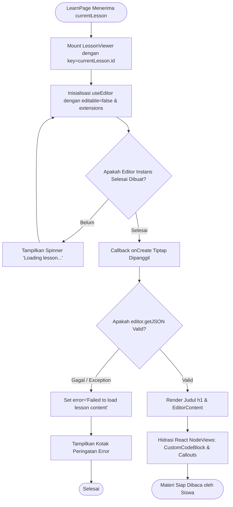
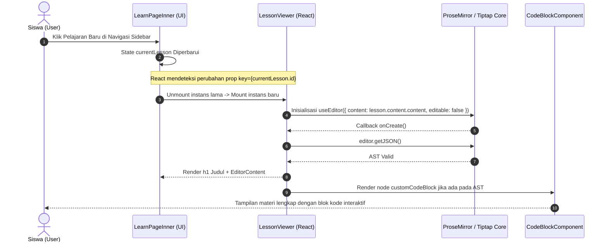

# 📖 Subsistem: WYSIWYG Lesson Reader Engine

Dokumen spesifikasi teknis mengenai engine pembaca konten materi teks teknis (*technical reading engine*) berbasis headless Tiptap ProseMirror pada platform Maguru.

---

## 1. Topologi File & Tanggung Jawab Modul

```
maguru/
├── features/cms/components/student/
│   └── LessonViewer.tsx                              # Komponen utama perender dokumen materi
├── components/tiptap-node/                           # Stylesheet modular per-tipe blok node
│   ├── heading-node/heading-node.scss
│   ├── paragraph-node/paragraph-node.scss
│   ├── list-node/list-node.scss
│   ├── code-block-node/code-block-node.scss
│   ├── callout-node/callout-node.scss
│   ├── blockquote-node/blockquote-node.scss
│   ├── table-node/table-node.scss
│   ├── columns-node/columns-node.scss
│   └── details-node/details-node.scss
└── components/tiptap-templates/simple/
    └── simple-editor.scss                            # Baseline layout & typography editor
```

- **`LessonViewer.tsx`**: Komponen React Client yang menginisialisasi instans Tiptap ProseMirror dalam mode *read-only* (`editable: false`), memvalidasi AST JSON, dan me-render dokumen materi.
- **SCSS Node Modules**: Stylesheet individual yang memastikan setiap elemen (seperti tabel, accordion details, callout box, dan blok kode) di-render dengan tipografi dan warna tema *Atelier Zero* yang identik antara ruang belajar siswa dan editor kreator.

---

## 2. Arsitektur & Cara Kerja Internal

### 2.1 Mode Read-Only & Inisialisasi Tiptap
1. **Headless Engine**: Menggunakan hook `useEditor` dari `@tiptap/react` dengan konfigurasi:
   - `editable: false`: Menonaktifkan kursor ketik, *selection handles* editable, dan modifikasi DOM oleh pengguna.
   - `immediatelyRender: false`: Mencegah *hydration mismatch* antara render server (SSR) dan render klien.
   - `shouldRerenderOnTransaction: false`: Mengoptimalkan performa browser agar tidak melakukan re-render berlebihan saat ada transaksi pasif pada dokumen.
2. **Steril Remounting Lifecycle**:
   - Komponen dipasang di halaman belajar dengan properti `key={lesson.id}`:
     ```tsx
     <LessonViewer key={currentLesson.id} lesson={currentLesson} />
     ```
   - **Tujuan Arsitektur**: Memaksa React melepaskan (*unmount*) instans ProseMirror lama dan membangun instans baru dari nol ketika siswa berpindah materi. Hal ini menghilangkan risiko kebocoran memori (*memory leak*), membersihkan tumpukan *undo/redo history*, dan menjamin tidak ada residu DOM materi sebelumnya yang tertinggal.

### 2.2 Ekstensi Tiptap yang Didukung
Renderer memuat seluruh ekstensi yang sama persis dengan editor kreator demi menjamin kepatuhan *WYSIWYG 100%*:
- **`StarterKit`**: Bold, Italic, Strike, BulletList, OrderedList, Blockquote, HorizontalRule.
- **`CustomCodeBlock`**: Interactive code block dengan pemilih bahasa dan engine runner terminal (Pyodide & JS).
- **`Callout`**: Kotak sorotan informasi dengan border kiri aksen, ikon tipe (Info, Warning, Tip, Note), dan background halus.
- **`Columns` & `Column`**: Tata letak grid multi-kolom responsif untuk komparasi konsep berdampingan.
- **`Table`, `TableRow`, `TableHeader`, `TableCell`**: Tabel teknis dengan styling cell border tipis tanpa resize-handle aktif.
- **`Details`, `DetailsSummary`, `DetailsContent`**: Blok akordion (*collapsible details*) untuk menyembunyikan kunci jawaban, spoiler, atau penjabaran rumus panjang.
- **`Typography`, `Highlight`, `Superscript`, `Subscript`**: Tipografi matematika dan pemformatan teks tingkat lanjut.

---

## 3. Keandalan, Error Handling & UX Feedback

| Skenario | Penanganan Sistem | Umpan Balik Visual Pengguna |
| :--- | :--- | :--- |
| **Pemuatan Dokumen Awal** | Kondisi `!editor` sebelum ProseMirror selesai diinisialisasi. | Spinner loading berputar dengan teks status: `"Loading lesson..."`. |
| **AST JSON Rusak / Null** | Blok try-catch pada callback `onCreate` memverifikasi `editor.getJSON()`. | Kotak alert error (`lesson-viewer-error`) bertuliskan: `"Failed to load lesson content. Please try refreshing the page."` |
| **Animasi Pergantian Bab** | Kelas utility CSS `animate-fade-in` pada container area materi. | Transisi halus opasitas dokumen baru tanpa kedipan layar (*flicker*). |
| **Pembatasan Lebar Baca (Ergonomi)** | Selektor `max-w-4xl mx-auto` dengan padding responsif `p-6 md:p-10`. | Panjang baris teks terjaga pada 65–75 karakter per baris untuk kenyamanan mata siswa. |

---

## 4. UML Activity Diagram: Rendering Materi Pelajaran



---

## 5. UML Sequence Diagram: Siklus Hidup Rendering Materi



---

## 6. Audit Edge Cases & Rekomendasi Ketahanan Kode

1. **Perlindungan Terhadap XSS (Cross-Site Scripting)**:
   - Tiptap ProseMirror memproses dokumen dalam bentuk terstruktur (AST JSON), bukan string HTML mentah (`dangerouslySetInnerHTML`). Hal ini secara otomatis menetralkan tag skrip berbahaya yang mungkin disisipkan di dalam teks.
2. **Konsistensi Gaya CSS pada Dark Mode**:
   - Seluruh stylesheet node Tiptap menggunakan variabel token CSS semantik (`bg-card`, `text-foreground`, `border-border/10`) sehingga peralihan tema terang (*parchment*) dan gelap (*slate-night*) tetap kontras dan nyaman dibaca tanpa teks yang pudar.
3. **Penyelarasan Skala Huruf (Font Scaling)**:
   - Judul materi menggunakan font display Manrope dengan bobot `font-extrabold` dan ukuran `text-3xl`, memberikan hierarki visual yang jelas terhadap konten paragraf pembuka.
