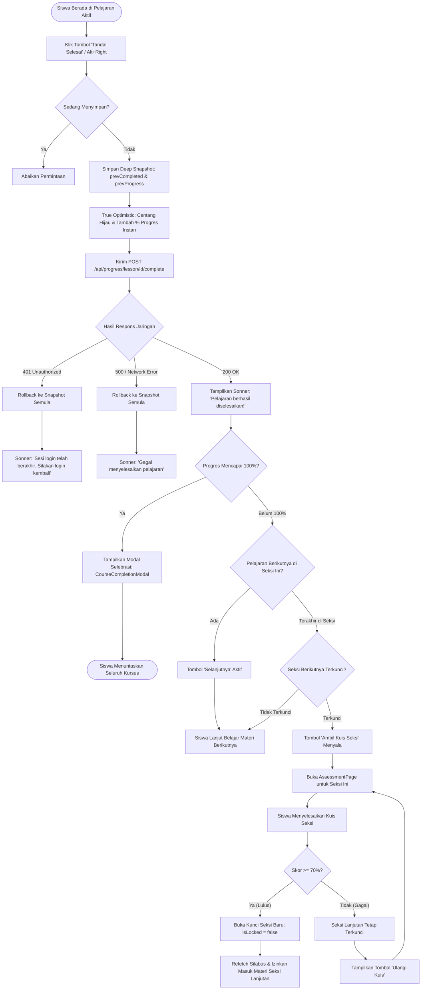
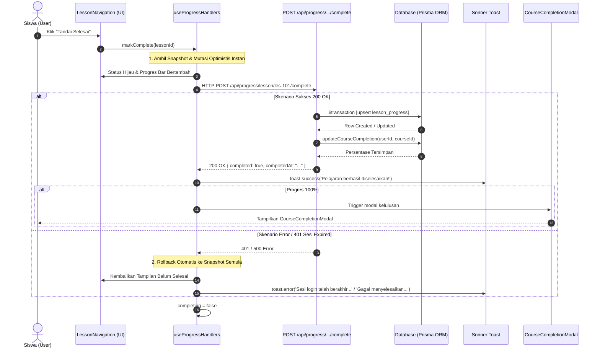

# 📊 Subsistem: Progress Tracking & Adaptive Gating Engine

Dokumen spesifikasi teknis mengenai engine pelacak kemajuan belajar siswa, kalkulasi persentase kelulusan kursus, dan mekanisme adaptif pembukaan silabus (*adaptive section gating*) pada platform Maguru.

---

## 1. Topologi File & Tanggung Jawab Modul

```
maguru/
├── features/cms/
│   ├── hooks/learn/
│   │   ├── useCourseLearn.ts                         # Hook pemuatan data kursus & gating
│   │   └── useProgressHandlers.ts                    # Hook penanganan mutasi penyelesaian materi
│   ├── components/student/
│   │   ├── ProgressBar.tsx                           # Visual progress bar persentase
│   │   ├── LessonNavigation.tsx                      # Kontrol aksi "Tandai Selesai" & "Ambil Kuis"
│   │   └── CourseNavigation.tsx                      # Sidebar navigasi silabus dengan indikator gembok
│   └── services/
│       ├── progress.service.ts                       # Logika bisnis kalkulasi progres & transaksi DB
│       └── section.service.ts                        # Evaluasi kelulusan kuis & status kunci seksi
└── app/api/
    ├── progress/course/[slug]/route.ts               # GET progres kursus siswa
    ├── progress/course/[slug]/lessons/route.ts       # GET daftar ID pelajaran terselesaikan
    └── progress/lesson/[lessonId]/complete/route.ts  # POST tandai materi selesai
```

- **`useProgressHandlers.ts`**: Menyediakan fungsi `markComplete` dengan proteksi konkurensi (`completing`), pembaruan antarmuka secara optimis, dan orkestrasi notifikasi toast Sonner.
- **`progress.service.ts`**: Mengelola transaksi basis data atomik (`prisma.$transaction`) untuk meng-upsert baris `lesson_progress` serta memperbarui tabel ringkasan `course_completions`.
- **`section.service.ts`**: Menghubungkan data kuis evaluasi (`user_assessments`) untuk menentukan apakah sebuah seksi terbuka (`isLocked = false`) atau masih terkunci bagi siswa.

---

## 2. Arsitektur & Cara Kerja Internal

### 2.1 Formula Kalkulasi Persentase Progres
Persentase kemajuan kursus dihitung secara dinamis baik di sisi klien (untuk responsivitas instan) maupun di sisi server (sebagai *source of truth*):

$$\text{Persentase} = \begin{cases} 0 & \text{jika } \text{totalLessons} = 0 \\ \text{round}\left(\frac{\text{completedLessons}}{\text{totalLessons}} \times 100, 2\right) & \text{jika } \text{totalLessons} > 0 \end{cases}$$

Pada antarmuka pengguna (`ProgressBar.tsx`), angka persentase dibungkus dengan kelas Tailwind `tabular-nums` untuk mencegah pergeseran tata letak horizontal (*zero layout shift*) saat digit berubah dari satu angka ke dua atau tiga angka.

### 2.2 Alur Mutasi Optimistis & Kunci Konkurensi
1. **Concurrency Lock**: State `completing` disetel ke `true` saat tombol ditekan. Klik berikutnya selama permintaan jaringan masih berjalan akan langsung dibatalkan (`if (completing) return`).
### 2.2 Alur Mutasi Optimistis & Snapshot Rollback
1. **Concurrency Lock**: State `completing` disetel ke `true` saat tombol ditekan. Klik berikutnya selama permintaan jaringan masih berjalan akan langsung dibatalkan (`if (completing) return`).
2. **Snapshot Memori & True Optimistic Update**:
   - Sistem mengambil *deep snapshot* sebelum mutasi:
     ```typescript
     let prevCompletedSnapshot: Set<string> | null = null
     let prevProgressSnapshot: CourseProgress | null = null

     setCompletedLessonIds((prev) => {
       prevCompletedSnapshot = new Set(prev)
       return new Set([...prev, lessonId])
     })
     ```
   - Ikon tombol pada `LessonNavigation.tsx` seketika berubah menjadi centang hijau dan persentase bertambah instan di UI.
3. **Persistensi Basis Data Atomik**:
   - Endpoint `POST /api/progress/lesson/[lessonId]/complete` menjalankan transaksi Prisma `$transaction` dengan `upsert` pada `lesson_progress`.
   - Di luar transaksi, service memanggil `updateCourseCompletion` untuk menyinkronkan tabel `course_completions`.
4. **Rollback Otomatis & Deteksi 401**:
   - Jika jaringan error atau sesi login berakhir (HTTP 401), sistem secara otomatis mengembalikan state klien ke `prevCompletedSnapshot` dan `prevProgressSnapshot`, serta memunculkan toast peringatan yang informatif.

### 2.3 Aturan Pembukaan Seksi Adaptif (*Adaptive Section Gating*)
Sistem menerapkan dua lapis aturan akses pembelajaran:

1. **Aturan Evaluasi Awal (Pre-Test Gating)**:
   - Jika siswa belum pernah mengerjakan Pre-Test untuk kursus terkait (`preTestCompleted === false`), seluruh seksi di sidebar dinonaktifkan (`isLocked = true`). Siswa diwajibkan menyelesaikan tes diagnostik terlebih dahulu.
2. **Aturan Kuis Seksi (Section Quiz Gating $\ge 70\%$)**:
   - Seksi pertama (`index === 0`) selalu terbuka untuk siswa yang telah menyelesaikan Pre-Test.
   - Untuk seksi lanjutan (`index > 0`), seksi berstatus **Terkunci** (`isLocked = true`) kecuali jika siswa telah lulus kuis seksi sebelumnya dengan skor minimal 70%:
     ```typescript
     // app/api/courses/[slug]/sections/route.ts
     const passedQuizzes = await prisma.user_assessments.findMany({
       where: {
         userId,
         courseId: result.courseId,
         type: 'SECTION_QUIZ',
         score: { gte: 70 },
       },
       select: { sectionId: true },
     })
     ```

---

## 3. Keandalan, Error Handling & UX Feedback

| Potensi Isu | Mekanisme Proteksi | Umpan Balik Visual Pengguna |
| :--- | :--- | :--- |
| **Spam Klik Cepat (*Double-Click*)** | Pengecekan guard `if (completing) return`. | Tombol dinonaktifkan sementara dan tidak memicu multiple request. |
| **Koneksi Jaringan Putus saat Simpan** | Tangkapan try-catch + pemulihan snapshot memori lokal. | State otomatis di-rollback ke kondisi belum selesai + Sonner toast merah: `toast.error(err.message)`. |
| **Sesi Supabase Auth Expired (401)** | Deteksi status HTTP 401 pada penandaan materi + pemulihan snapshot otomatis. | Sonner toast: `toast.error('Sesi login telah berakhir. Silakan login kembali...')`. |
| **Penyelesaian Berhasil** | Status HTTP 200 dari endpoint penyelesaian. | Sonner toast hijau melayang: `toast.success('Pelajaran berhasil diselesaikan!')`. |
| **Milestone Kelulusan (100%)** | Pemicu otomatis di `LearnPageInner` saat `progress.percentage >= 100%`. | Modal selebrasi kelulusan (`CourseCompletionModal`) dengan statistik kurikulum tuntas. |
| **Pemeriksaan Sesi Auth Siswa Lambat** | Timeout balapan 2000ms pada rute `/api/progress/course/[slug]/lessons`. | Mengembalikan `{ completedLessonIds: [] }` alih-alih melempar status HTTP 500. |
| **Seksi Berikutnya Masih Terkunci** | Evaluasi prop `isNextSectionLocked` di `LessonNavigation`. | Tombol berganti menjadi `Ambil Kuis Seksi` dengan aksen coral cerah. |

---

## 4. UML Activity Diagram: Penyelesaian Materi & Gating Kuis



---

## 5. UML Sequence Diagram: Mutasi Progres & Gating Seksi



---

## 6. Audit Edge Cases & Rekomendasi Ketahanan Kode

1. **Rollback State pada Kegagalan Jaringan**:
   - *Status Implementasi*: **Telah Diimplementasikan**. `useProgressHandlers.ts` kini menyimpan `prevCompletedSnapshot` dan `prevProgressSnapshot` sebelum mutasi optimis dikirimkan ke server. Jika respons non-200 terjadi, state dipulihkan seketika tanpa perlu me-refresh browser.
2. **Kalkulasi Ulang Persentase Otomatis Saat Kurikulum Diubah Kreator**:
   - Jika kreator menambahkan pelajaran baru ke dalam kursus yang sudah dipelajari siswa, nilai `totalLessons` akan meningkat. Service `calculateCourseCompletion` secara cerdas menghitung ulang persentase berdasarkan total materi riil terbaru.
3. **Idempoten Transaksi**:
   - Operasi `upsert` pada `lesson_progress` menjamin sifat idempoten: memanggil rute ini berulang kali dengan parameter yang sama tidak akan menduplikasi baris database karena terikat pada indeks unik `@@unique([lessonId, userId])`.

