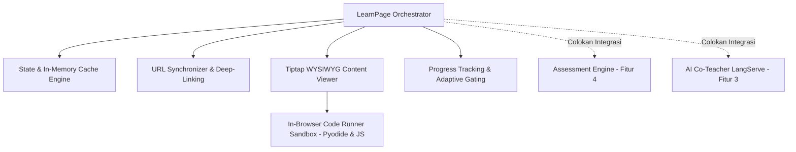
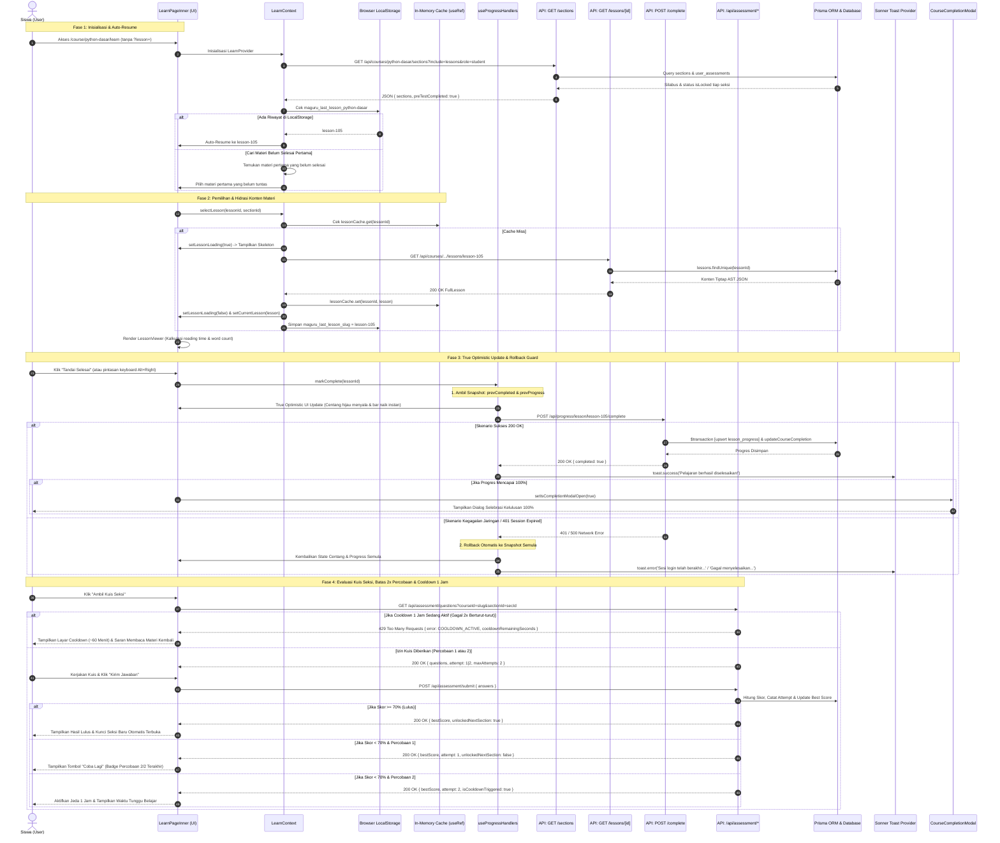

# 🧭 Alur Sistem Pembelajaran Siswa (Student Learning Experience & Course Reader)

Dokumen ini merupakan spesifikasi teknis mendalam mengenai arsitektur, subsistem turunan, alur data (data flow), penanganan keandalan (error handling & optimistic updates), umpan balik pengguna (Sonner toast & loading states), serta diagram UML (Activity & Sequence) untuk fitur **Sistem Pembelajaran Siswa** di platform Maguru.

---

## 1. Topologi File & Tanggung Jawab 3-Tier

Arsitektur fitur pembelajaran siswa menerapkan pola **Modular Monolith 3-Tier** (Presentation, Logic, Data/API) yang bersih dan terisolasi:

```
maguru/
├── app/(learn)/course/[slug]/learn/
│   ├── layout.tsx                                    # Isolasi layout (menghilangkan navbar umum)
│   └── page.tsx                                      # Orchestrator utama halaman belajar
├── features/cms/
│   ├── Context/student/
│   │   └── LearnContext.tsx                          # Global State Provider modul belajar
│   ├── hooks/learn/
│   │   ├── useCourseLearn.ts                         # Hook pemuatan data kursus & gating
│   │   ├── useLessonLearn.ts                         # Hook navigasi materi & in-memory cache
│   │   └── useProgressHandlers.ts                    # Hook mutasi progress & optimisme UI
│   ├── components/student/
│   │   ├── CourseNavigation.tsx                      # Sidebar navigasi silabus kursus
│   │   ├── LessonViewer.tsx                          # Renderer dokumen materi Tiptap
│   │   ├── LessonNavigation.tsx                      # Kontrol materi Sebelumnya / Selanjutnya
│   │   ├── ProgressBar.tsx                           # Visual progress bar persentase
│   │   └── LearnHeader.tsx                           # Header navigasi & status kuis
│   ├── components/creator/manage/editor/
│   │   ├── components/CodeBlockComponent.tsx         # NodeView interactive code runner
│   │   └── extensions/CustomCodeBlock.ts             # Tiptap Code Block extension
│   └── services/
│       ├── section.service.ts                        # Query section & aturan akses siswa
│       ├── lesson.service.ts                         # Query konten pelajaran
│       └── progress.service.ts                       # Kalkulasi agregasi persentase progres
├── features/assessment-engine/                       # Subsistem Gating & Evaluasi
│   └── components/
│       ├── AssessmentPage.tsx                        # Runner kuis Pre-Test & Section Quiz
│       ├── AssessmentResultPage.tsx                  # Tampilan analisis hasil skor & rekomendasi
│       └── AssessmentErrorBoundary.tsx               # Error boundary pelindung modul kuis
├── features/langserve/                               # Subsistem Pendamping Belajar AI
│   └── components/ChatbotAssistant.tsx               # Floating AI Co-Teacher modal & drawer
├── lib/code-runner/
│   └── runner.ts                                     # Engine WebAssembly (Pyodide) & JS Sandbox
└── app/api/                                          # Data Layer / Kontrak Endpoint API
    ├── courses/[slug]/sections/route.ts              # GET silabus & status gating kuis
    ├── courses/[slug]/sections/[sectionId]/lessons/[lessonId]/route.ts # GET payload konten materi
    ├── progress/course/[slug]/route.ts               # GET progres kursus siswa
    ├── progress/course/[slug]/lessons/route.ts       # GET daftar ID pelajaran terselesaikan
    └── progress/lesson/[lessonId]/complete/route.ts  # POST tandai materi selesai (upsert)
```

---

## 2. Subsistem Terintegrasi & Direktori Subsistem

Sistem Pembelajaran Siswa bertindak sebagai **Master Orchestrator** yang mengoordinasikan subsistem internal serta menghubungkan antarmuka ke subsistem eksternal:



### 2.1 Subsistem Internal Berkas Terpisah (`subsystems/`)
Setiap subsistem inti yang memiliki kompleksitas teknis dan siklus hidup independen telah didokumentasikan dalam berkas terpisah:

1. **[⚙️ `subsystems/code-runner.md` (In-Browser Code Runner Sandbox)](file:///d:/.maguru/maguru/docs/feature/student-learning/subsystems/code-runner.md)**:
   - Eksekusi Python berbasis Pyodide WebAssembly v0.26.4 (CDN lazy-loading singleton).
   - Eksekusi JavaScript/TypeScript terisolasi via `new Function` dengan *timeout guard* 5000ms anti *infinite loop*.
   - Antarmuka laci terminal *Atelier Zero* dengan indikator waktu eksekusi milidetik dan tangkapan `stdout`/`stderr`.
2. **[📖 `subsystems/lesson-reader.md` (WYSIWYG Lesson Reader Engine)](file:///d:/.maguru/maguru/docs/feature/student-learning/subsystems/lesson-reader.md)**:
   - Renderer headless Tiptap ProseMirror dalam mode *read-only* steril (`key={currentLesson.id}`).
   - Dukungan node teknis: `CustomCodeBlock`, `Callout`, `Columns`, `Table`, `Details` (accordion), `Typography`, `Superscript`, dan `Subscript`.
   - Validasi struktur AST JSON, proteksi XSS bawaan, dan penanganan status pemuatan (*skeleton loading*).
3. **[📊 `subsystems/progress-gating.md` (Progress Tracking & Adaptive Gating)](file:///d:/.maguru/maguru/docs/feature/student-learning/subsystems/progress-gating.md)**:
   - Logika mutasi penyelesaian materi dengan *concurrency guard* (`completing`), pembaruan UI instan, dan notifikasi Sonner.
   - Transaksi database atomik Prisma (`$transaction` upsert `lesson_progress`) & kalkulasi persentase kelulusan.
   - Aturan pembukaan seksi adaptif: wajib lulus Pre-Test dan kuis seksi sebelumnya dengan skor $\ge 70\%$.

### 2.2 Subsistem Orkestrasi Halaman Utama
- **State & In-Memory Cache Engine**: [`features/cms/Context/student/LearnContext.tsx`](file:///d:/.maguru/maguru/features/cms/Context/student/LearnContext.tsx) mengelola `lessonCache` (`useRef<Map<string, FullLesson>>`) untuk hidrasi $0\text{ ms}$ saat berpindah antar materi yang sudah pernah dibuka.
- **URL Synchronizer & Deep-Linking**: [`app/(learn)/course/[slug]/learn/page.tsx`](file:///d:/.maguru/maguru/app/(learn)/course/[slug]/learn/page.tsx) menyinkronkan parameter `?lesson=[lessonId]` via `router.replace(..., { scroll: false })` sehingga posisi belajar dapat di-*share* atau di-*bookmark*.

### 2.3 Colokan Integrasi Fitur Eksternal (*Seams & Adapters*)
- **Modul Kuis Evaluasi (Assessment Engine)**: Terintegrasi via `<AssessmentPage>` dan `<AssessmentErrorBoundary>`. Didokumentasikan secara mandiri di [`docs/feature/assessment-engine/`](file:///d:/.maguru/maguru/docs/feature/assessment-engine/readme.md).
- **Asisten Mentor AI (AI Co-Teacher)**: Terintegrasi via `<ChatbotAssistant>` dengan konteks aktif materi. Didokumentasikan secara mandiri di [`docs/feature/ai-co-teacher/`](file:///d:/.maguru/maguru/docs/feature/ai-co-teacher/readme.md).

---


## 3. Keandalan, Error Handling & UX Feedback

| Area | Mekanisme Pertahanan & Resiliensi | UX Feedback Pengguna |
| Area | Mekanisme Pertahanan & Resiliensi | UX Feedback Pengguna |
| :--- | :--- | :--- |
| **Pemuatan Awal Kursus** | `Promise.all` paralel fetching (sections + progress + completed) dengan try-catch terpusat di `useCourseLearn`. | Spinner animasi berputar (`Memuat kursus...`). Jika gagal, card alert error dengan tombol `Kembali ke Kursus`. |
| **Pemuatan Konten Materi** | In-memory caching (`lessonCache`) untuk kunjungan ulang. Try-catch dengan handling respons non-ok di `useLessonLearn`. | Skeleton pulse animasi (4 balok placeholder teks & gambar) selama materi dimuat. |
| **Auto-Resume Belajar** | Deteksi `localStorage.getItem(maguru_last_lesson_slug)` atau materi pertama yang belum diselesaikan (`!completedLessonIds.has`). | Siswa langsung diarahkan ke bab terakhir yang sedang dipelajari tanpa terlempar ke bab awal. |
| **Estimasi Waktu Baca** | Kalkulasi kata pada AST Tiptap ($w / 200 \text{ wpm}$) minimum 1 menit di `LessonViewer`. | Badge mengambang `⏱️ X min baca` dan `Y kata` di samping judul materi. |
| **Pintasan Keyboard** | Event listener window `keydown` untuk kombinasi `Alt + ArrowRight` dan `Alt + ArrowLeft`. | Navigasi materi cepat tanpa perlu menggerakkan mouse (dikecualikan saat mengetik di input/kode). |
| **Penyelesaian Materi (True Optimistic)** | Concurrency guard (`if (completing) return`) + snapshot rollback jika request jaringan gagal/timeout. | State centang dan progres bar bertambah seketika. Sonner toast sukses: `toast.success('Pelajaran berhasil diselesaikan!')`. |
| **Sesi Auth Expired (401)** | Deteksi status HTTP 401 pada penandaan materi + pemulihan snapshot otomatis. | Sonner toast peringatan: `toast.error('Sesi login telah berakhir. Silakan login kembali...')`. |
| **Milestone Kelulusan (100%)** | Deteksi otomatis saat `progress.percentage >= 100%` pada `LearnPageInner`. | Modal selebrasi kelulusan (`CourseCompletionModal`) dengan statistik kurikulum tuntas dan tombol katalog. |
| **Konektivitas Auth Lambat** | Timeout guard 2000ms pada endpoint `/api/progress/course/[slug]/lessons` (`Promise.race`). | Mencegah halaman hang; mengembalikan fallback aman array kosong `{ completedLessonIds: [] }`. |
| **Crash Modul Kuis** | `<AssessmentErrorBoundary>` membungkus komponen `<AssessmentPage>`. | Fallback UI khusus kuis mencegah seluruh aplikasi crash jika terjadi kegagalan kalkulasi skor. |
| **Eksekusi Kode Siswa** | Sandboxing WebAssembly lokal dengan penangkapan `stderr` dan penandaan status `error`. | Output merah interaktif pada drawer terminal mini tanpa me-refresh halaman. |

---

## 4. UML Activity Diagram: Alur Belajar, Auto-Resume & Gating Siswa

Diagram aktivitas berikut menggambarkan seluruh alur keputusan dari inisialisasi cerdas (*auto-resume*), tes diagnostik, pembacaan materi, eksekusi kode, hingga selebrasi kelulusan 100%:

```mermaid
flowchart TD
    Start([Siswa Masuk ke /course/slug/learn]) --> InitFetch[Fetch Paralel: Silabus, Status Kuis & Progres]
    InitFetch --> CheckLoading{Apakah Data Berhasil Dimuat?}

    CheckLoading -- Gagal --> ShowError[Tampilkan Error Card + Tombol Kembali ke Kursus]
    ShowError --> EndFail([Selesai])

    CheckLoading -- Berhasil --> CheckPreTest{Apakah Pre-Test Sudah Selesai?}

    CheckPreTest -- Belum Selesai --> RenderPreTest[Kunci Navigasi Sidebar & Buka AssessmentPage Pre-Test]
    RenderPreTest --> SubmitPreTest[Siswa Mengerjakan & Mengirim Pre-Test]
    SubmitPreTest --> ShowPreTestResult[Tampilkan Analisis Skor & Rekomendasi Materi yang Dilewati]
    ShowPreTestResult --> ContinueToLearn[Klik Lanjut Belajar -> Refetch Silabus & Buka Akses Pelajaran]
    ContinueToLearn --> CheckUrlLesson

    CheckPreTest -- Sudah Selesai --> CheckUrlLesson{Apakah Ada Parameter ?lesson=id di URL?}
    CheckUrlLesson -- Ada --> LoadUrlLesson[Pilih Materi Sesuai Parameter URL]
    CheckUrlLesson -- Tidak Ada --> CheckLocalStorage{Ada Riwayat Belajar di LocalStorage?}

    CheckLocalStorage -- Ada --> LoadLastVisited[Auto-Resume ke Pelajaran Terakhir yang Disimpan]
    CheckLocalStorage -- Tidak Ada --> FindFirstUncompleted[Cari Pelajaran Belum Selesai Pertama di Seksi Terbuka]
    FindFirstUncompleted --> SelectFirstLesson[Auto-Select Materi Hasil Pencarian / Bab Pertama]

    LoadUrlLesson --> CheckCache{Cek In-Memory Cache}
    LoadLastVisited --> CheckCache
    SelectFirstLesson --> CheckCache

    CheckCache -- Ada di Cache --> RenderImmediate[Hidrasi Konten Instan 0ms dari Cache]
    CheckCache -- Tidak Ada --> FetchLessonApi[GET /api/courses/slug/sections/.../lessons/id]
    FetchLessonApi --> SaveCache[Simpan ke In-Memory Cache]
    SaveCache --> RenderImmediate

    RenderImmediate --> CalcReadingTime[Hitung Estimasi Waktu Baca & Render Badge Kata]
    CalcReadingTime --> SyncLocalStorage[Simpan ID Materi ke maguru_last_lesson_slug]
    SyncLocalStorage --> StudentAction{Aktivitas Siswa}

    StudentAction -- Baca & Pelajari Materi --> StudentAction
    StudentAction -- Navigasi Cepat Keyboard Alt+Panah --> KeyboardNav[Pindah Pelajaran Sebelumnya / Selanjutnya]
    KeyboardNav --> CheckCache
    
    StudentAction -- Jalankan Kode pada Materi --> RunCodeEngine[Eksekusi via Pyodide WebAssembly / JS Sandbox]
    RunCodeEngine --> ShowTerminal[Tampilkan Output stdout/stderr pada Panel Terminal]
    ShowTerminal --> StudentAction

    StudentAction -- Tanya AI Pendamping --> OpenChatbot[Buka Floating Co-Teacher Drawer Berisi Konteks Materi]
    OpenChatbot --> StudentAction

    StudentAction -- Klik Tombol 'Tandai Selesai' --> ConcurrencyCheck{Apakah Sedang Memproses?}
    ConcurrencyCheck -- Ya --> IgnoreClick[Abaikan Klik Berulang]
    ConcurrencyCheck -- Tidak --> OptimisticStep[True Optimistic: Snapshot State Lalu Update Centang & Progres Instan]
    OptimisticStep --> SendCompleteApi[POST /api/progress/lesson/id/complete]

    SendCompleteApi -- Respons 200 OK --> ShowToastSuccess[Sonner: Pelajaran berhasil diselesaikan!]
    SendCompleteApi -- Respons 401 Sesi Habis --> RollbackState401[Rollback State ke Snapshot Semula]
    RollbackState401 --> ShowToast401[Sonner Error: Sesi login berakhir! Silakan login kembali]
    SendCompleteApi -- Respons Gagal Jaringan --> RollbackStateError[Rollback State ke Snapshot Semula]
    RollbackStateError --> ShowToastError[Sonner Error: Gagal menyelesaikan pelajaran!]

    ShowToastSuccess --> Check100Percent{Apakah Progres Mencapai 100%?}
    Check100Percent -- Ya (Tuntas) --> ShowCompletionModal[Munculkan Modal Selebrasi: CourseCompletionModal]
    ShowCompletionModal --> FinishCatalog([Kembali ke Katalog / Tinjau Ulang])

    Check100Percent -- Belum 100% --> CheckNextSection{Apakah Materi Terakhir & Seksi Berikutnya Terkunci?}
    CheckNextSection -- Ya --> PromptQuiz[Tombol 'Ambil Kuis Seksi' Menyala]
    PromptQuiz --> LoadQuizApi[GET /api/assessment/questions]
    
    LoadQuizApi -- Status 429 Cooldown Aktif --> ShowCooldownScreen[Layar Cooldown: Sisa Waktu ~60 Menit & Panduan Belajar]
    ShowCooldownScreen --> ReadLessonsAgain[Siswa Membaca Ulang Materi Bab]

    LoadQuizApi -- Status 200 OK --> TakeQuiz[Siswa Mengerjakan Soal Kuis - Percobaan 1 atau 2]
    TakeQuiz --> SubmitQuizApi[POST /api/assessment/submit]
    SubmitQuizApi --> CheckScore{Apakah Skor >= 70%?}
    
    CheckScore -- Ya (Lulus) --> UnlockNextSection[Seksi Baru Terbuka: isLocked = false]
    UnlockNextSection --> NextLesson[Lanjut ke Materi Seksi Baru]
    
    CheckScore -- Tidak (< 70%) --> SaveBestScore[Preservasi Skor Tertinggi di Database]
    SaveBestScore --> CheckAttemptLimit{Apakah Percobaan ke-2?}
    CheckAttemptLimit -- Belum (Percobaan 1) --> AllowRetry[Tampilkan Tombol 'Coba Lagi' - Badge Percobaan 2/2]
    AllowRetry --> TakeQuiz
    CheckAttemptLimit -- Sudah 2x Berturut-turut --> Trigger1HrCooldown[Aktifkan Jeda Cooldown 1 Jam - HTTP 429]
    Trigger1HrCooldown --> ShowCooldownScreen

    CheckNextSection -- Tidak --> NextLesson[Lanjut ke Materi Berikutnya]
    NextLesson --> RenderImmediate
```



---

## 5. UML Sequence Diagram: Interaksi Komponen & Kontrak Jaringan

Diagram sekuens berikut memetakan perjalanan pesan (*message sequence*) lengkap termasuk *auto-resume*, penanganan *snapshot rollback*, modal kelulusan 100%, serta siklus evaluasi kuis seksi dan *cooldown*:



---

## 6. Audit Edge Cases & Rekomendasi Ketahanan Kode

Berdasarkan audit mendalam terhadap penambahan fitur pada basis kode:

1. **Jaminan Privasi Akses LocalStorage**:
   - Pengecekan `localStorage` pada `LearnContext.tsx` dibungkus dengan blok `try-catch` terisolasi untuk mengantisipasi mode penjelajahan privat (*Incognito / Private Browsing*) pada browser tertentu yang memblokir akses penyimpanan lokal (*SecurityError*).
2. **Isolasi Pintasan Keyboard**:
   - Event listener `handleKeyDown` pada `LearnPageInner` secara ketat memverifikasi bahwa kursor pengguna tidak sedang aktif di elemen input formulir, textarea, atau blok kode Tiptap (`!target.closest('.tiptap')`) sebelum memproses navigasi `Alt + Panah`.
3. **Pencegahan Spam Modal Kelulusan**:
   - `LearnPageInner` mengelola flag `hasDismissedCompletion` dalam sesi lokal sehingga modal kelulusan 100% hanya muncul satu kali saat ambang batas tercapai, dan tidak mengganggu siswa yang ingin terus meninjau ulang materi.
4. **Ketahanan Rollback State UI**:
   - Fungsi `useProgressHandlers` menyimpan referensi memori *deep snapshot* sebelum memicu mutasi optimis, menjamin konsistensi visual antarmuka jika terjadi gangguan koneksi internet mendadak.


> Dokumen terkait:
> - Detail spesifikasi kontrak endpoint API: [Spesifikasi Kontrak API](file:///d:/.maguru/maguru/docs/feature/student-learning/api-contracts.md)
> - Ringkasan fitur & indeks: [Indeks Pembelajaran Siswa](file:///d:/.maguru/maguru/docs/feature/student-learning/readme.md)
