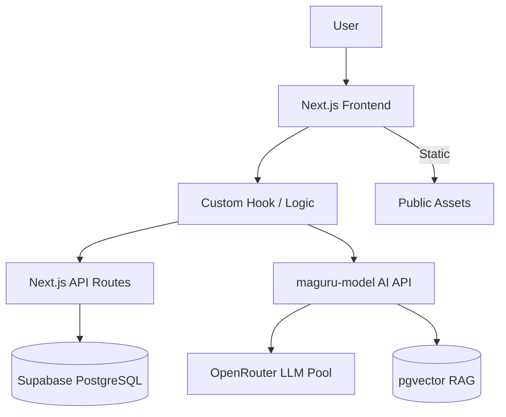

# 📐 Arsitektur Proyek Maguru (Full-Stack EdTech)

---

## 1. Prinsip Utama

- **Modular Monolith** dengan struktur layer yang ringkas dan efisien.
- **Layer N-tier**: 3 layer utama (Presentation, Logic, Data), tanpa subdivisi berlebihan.
- **Sederhana, maintainable, scalable** — cocok untuk tim kecil dan iterasi cepat.
- **AI Backend** terpisah sebagai service mandiri (`maguru-model`), terhubung ke frontend via HTTP/SSE.

---

## 2. High Level Architecture



- **Frontend**: Next.js App Router (React) — SSR, routing, komponen UI
- **Backend FE**: Next.js API Routes — CRUD, auth, validasi (Prisma ORM)
- **AI Backend**: Python FastAPI + LangGraph (`maguru-model`) — agent AI, streaming SSE
- **Database**: Supabase PostgreSQL (data + pgvector untuk RAG)

---

## 3. Struktur Folder — Next.js Frontend (`maguru/`)

```
/
├── app/                    # Next.js App Router
│   ├── api/                # API Routes (CRUD, auth)
│   ├── design-system/      # Halaman katalog komponen (/design-system)
│   └── ...                 # Page, layout, dsb
├── components/
│   ├── ui/                 # Atomic Shadcn UI components
│   └── shadcn-studio/      # Reusable studio UI elements
├── features/               # Modular feature slices
│   ├── design-system/
│   │   ├── components/demos/   # Demo showcase wrappers
│   │   └── lib/                # Component registry
│   └── [feature]/
│       ├── components/     # React UI components
│       ├── hooks/          # Custom hooks (state, fetching)
│       ├── services/       # Prisma CRUD logic
│       ├── api.ts          # API client/fetcher
│       └── types.ts        # TypeScript types
├── prisma/                 # Schema & migration
├── public/                 # Static assets
├── lib/                    # Global utilities
└── styles/                 # CSS/Tailwind config
```

---

## 4. Struktur Folder — AI Backend (`maguru-model/`)

```
app/
├── agents/                     # ← 4 Modular Agent Domains
│   ├── __init__.py             # Unified export semua agen
│   ├── co_teacher/             # Agent 1: Co-Teacher (Stateful LangGraph)
│   │   ├── __init__.py
│   │   ├── graph.py            # LangGraph StateGraph + nodes
│   │   ├── entrypoint.py       # LangServe chain factory + answer_question()
│   │   └── greeting.py         # Sub-fitur: AI greeting untuk siswa
│   ├── code_explainer/         # Agent 2: Code Explainer (Stateless LCEL)
│   │   ├── __init__.py
│   │   └── entrypoint.py       # LCEL chain factory
│   ├── hint_generator/         # Agent 3: Hint Generator (Stateless LCEL)
│   │   ├── __init__.py
│   │   └── entrypoint.py       # LCEL chain factory (3-level hints)
│   └── quiz_engine/            # Agent 4: Quiz Engine (Stateful LangGraph)
│       ├── __init__.py
│       ├── graph.py            # LangGraph StateGraph untuk generate quiz
│       └── entrypoint.py       # Quiz feedback + quiz generator chain
│
├── shared/                     # Shared utilities (single source of truth)
│   ├── __init__.py             # Re-export semua shared utils
│   ├── config.py               # → proxy ke app.core.config
│   ├── llm.py                  # → proxy ke app.core.llm
│   ├── checkpointer.py         # → proxy ke app.db.checkpointer
│   ├── vector_store.py         # → proxy ke app.db.vector_store
│   └── rag_service.py          # → proxy ke app.services.rag_service
│
├── core/                       # LLM config & settings
├── db/                         # Checkpointer & vector store
├── services/                   # RAG service
├── schemas/                    # Pydantic I/O schemas
├── prompts/                    # YAML prompt templates
├── api/                        # REST API routes (v1)
├── chains/                     # Legacy — backward-compat shims ke agents/
├── graphs/                     # Legacy — backward-compat shims ke agents/
└── main.py                     # FastAPI app factory
```

### Aturan Agen

| Domain | Jenis | Pattern | Endpoint |
|---|---|---|---|
| `co_teacher` | Stateful | LangGraph + RAG + Memory | `/chatbot`, `/greeting` |
| `code_explainer` | Stateless | LCEL chain | `/explain-code` |
| `hint_generator` | Stateless | LCEL chain | `/hint` |
| `quiz_engine` | Stateful | LangGraph + LCEL | `/generate-quiz`, `/quiz-feedback` |

---

## 5. Standardisasi Komponen UI (Frontend)

1. **`components/ui/`** — Komponen atomic dasar Shadcn UI (`button`, `input`, `badge`, dll).
2. **`components/shadcn-studio/`** — Reusable visual components (`card-art-skeuo`, `switch-skeuo`, dll).
3. **`features/design-system/components/demos/`** — Demo showcase wrappers.
4. **`features/design-system/lib/design-system-registry.tsx`** — Setiap komponen baru **WAJIB** didaftarkan di sini.
5. **`features/[fitur]/components/`** — WAJIB import dari `@/components/shadcn-studio/` atau `@/components/ui/`, jangan duplikasi markup.

---

## 6. Layer N-Tier (Frontend)

### 1. **Presentation Layer**
- Komponen React (UI), form, tabel.
- State lokal: `useState` / `useReducer`.
- Context hanya untuk global state (misal: user login).

### 2. **Logic Layer**
- Custom hook per fitur (`useProduct`, `useChat`, dll).
- Logic fetching, validasi, transformasi data.
- Panggil API via fetcher (`api.ts`).

### 3. **Data Layer**
- Next.js API Routes (`app/api/[fitur]/route.ts`).
- Prisma ORM → Supabase PostgreSQL.

---

## 7. Alur Data

### Frontend CRUD
1. User → Komponen → Custom Hook → API fetcher → Next.js API Route → Prisma → DB

### AI Chat (SSE Streaming)
1. User → `useAIChat` hook → `fetch /chatbot/stream` → FastAPI LangServe → Co-Teacher Agent → LLM Pool → token stream → UI

---

## 8. Pembagian Area Kerja

### **Frontend Developer (FE)**
- `features/[fitur]/components/` — UI components
- `features/[fitur]/hooks/` — Custom hooks
- `app/` — Routing & layout Next.js

### **Backend Developer (BE)**
- `app/api/[fitur]/route.ts` — API Routes
- `features/[fitur]/services/` — Prisma CRUD
- `prisma/` — Schema & migration

### **AI Engineer**
- `maguru-model/app/agents/[agent]/` — Logic agen modular
- `maguru-model/app/shared/` — Shared utilities
- `maguru-model/app/prompts/` — Prompt templates YAML

---

## 9. Best Practice

- **Keep it simple!** — Modularisasi per fitur, jangan over-engineer.
- Gunakan TypeScript (FE) dan type hints Python (AI backend).
- Error handling: tampilkan pesan error/fallback UI yang ramah.
- Testing: unit test untuk logic utama di setiap layer.
- Context hanya jika benar-benar perlu global state.
- Setiap agen AI baru → buat folder baru di `app/agents/[nama]/` dengan `entrypoint.py`.

---

## 10. FAQ Developer

**Q: Cara tambah fitur UI baru?**
A: Buat folder di `features/[fitur]/`, isi dengan `components/`, `hooks/`, `api.ts`, `types.ts`.

**Q: Cara tambah agen AI baru?**
A: Buat folder `app/agents/[nama]/` dengan `entrypoint.py` (LCEL) atau `graph.py` + `entrypoint.py` (LangGraph). Daftarkan di `app/agents/__init__.py` dan `app/main.py`.

**Q: Bagaimana logic yang dipakai banyak fitur?**
A: Frontend → `/lib`. AI Backend → `/app/shared/`.

**Q: Deployment AI backend?**
A: Lokal via `uvicorn server:app`. AgentCore-ready (entrypoint pattern) untuk future cloud deploy.

---

**Jika ada pertanyaan atau butuh contoh implementasi, silakan diskusi di tim!**
