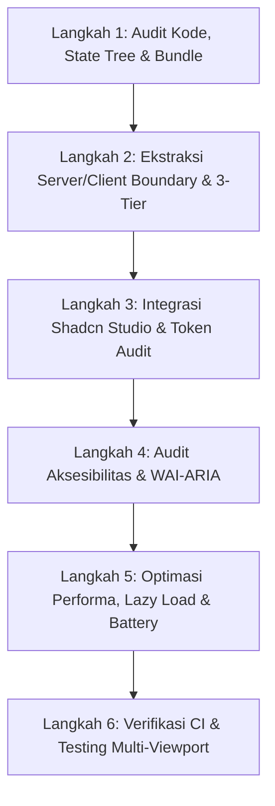

# Standard Operating Procedure (SOP): Clean Code, Modular Architecture & UI/UX Page Refactoring
**Versi:** 2.0  
**Tanggal:** 20 September 2026  
**Status:** Dokumen Resmi Tunggal (*Single Source of Truth* untuk Refactoring & Pembuatan Halaman)  
**Target Platform:** Tablet & Desktop Only (Minimal Lebar Layar 768px, Optimal 1024px–1440px+)  
**Kebijakan Mobile:** Mobile (< 768px) Dibatasi dengan Layar Barrier Informatif (`MobileDeviceNotice`)  
**Dokumen Pendukung:** [`design-system.md`](../../.agents/rules/design-system.md) & [`sop-design-system.md`](../../.agents/rules/sop-design-system.md)

---

## 1. Latar Belakang & Tujuan

Dokumen ini disusun untuk memandu pengembang dalam merefaktor, mengoptimasi, dan membangun setiap halaman (`page.tsx`) di **Maguru** dengan standar kualitas rekayasa perangkat lunak tertinggi (*enterprise-grade code quality*). Sebagai platform kursus daring interaktif berbasis teks (*text-based learning* ala Dicoding) dengan asisten AI Agent terintegrasi bertema *Whimsical Ancient Fantasy Asia*, dokumen ini mengeliminasi masalah umum berikut:

- **Code Duplication & God Components**: Menghapus komponen monolitik (> 300 baris) yang menggabungkan logika materi, runner kuis, state AI chat, dan markup UI dalam satu berkas.
- **Client/Server Monolith Leakage**: Mencegah penempatan direktif `"use client"` di tingkat teratas `page.tsx` yang merusak SEO, menghambat web crawler/LLM indexing, dan membengkakkan ukuran JavaScript bundle awal.
- **Deep Prop Drilling**: Menghindari passing props lebih dari 2–3 tingkat tanpa pemanfaatan composition pattern atau hook modular.
- **Inline Arbitrary Hex Colors**: Menghapus kelas Tailwind dengan bracket acak seperti `bg-[#123456]` atau `text-[#abcdef]` demi kepatuhan 100% pada palet resmi Maguru.
- **Aksesibilitas yang Buruk**: Memperbaiki touch target sempit (< 44px) pada navigasi smartphone, ketiadaan WAI-ARIA pada drawer silabus/opsi kuis, dan jebakan fokus keyboard.
- **Regresi Performa, Layout Shift & Battery Drain**: Mengeliminasi Cumulative Layout Shift (CLS > 0.1) saat sintaks kodingan di-highlight, serta mematikan animasi berat dan streaming AI yang tidak aktif saat tab browser di-minimize.

---

## 2. The 10 Core Engineering & UX Pillars

Setiap halaman modul materi, dashboard kursus, kuis, atau halaman profil di Maguru wajib dievaluasi dan diselaraskan terhadap 10 pilar berikut:

```
┌────────────────────────────────────────────────────────────────────────┐
│               10 PILAR REFACTORING & CLEAN CODE MAGURU                 │
│                                                                        │
│  [1] DRY & Modular Monolith (3-Tier)  [6] Below-the-Fold Lazy Loading │
│  [2] Server/Client Island Boundary    [7] Mobile Battery & Visibility │
│  [3] Single Component Library         [8] WCAG 2.2 & WAI-ARIA Semantics│
│  [4] Strict 0% Arbitrary Hex Tokens   [9] Mobile-First Ergonomics (44px)
│  [5] Zero-CLS & Reading Ergonomics    [10] Resilient 4-State Matrix   │
└────────────────────────────────────────────────────────────────────────┘
```

### 1. DRY & Modular Monolith (3-Tier Layering)
Sesuai arsitektur resmi Maguru, kode dipisahkan ke dalam 3 layer terisolasi:
1. **Presentation Layer (`features/[fitur]/components/`)**: Komponen UI murni. Dilarang keras melakukan query database Prisma langsung, pemanggilan SQL mentah, atau mutasi state global di file JSX ini.
2. **Logic Layer (`features/[fitur]/hooks/`)**: Custom React hook per fitur (`useCourseReader`, `useQuizRunner`, `useAIAgentMentor`). Mengelola state lokal, validasi jawaban kuis, streaming chat AI, dan sinkronisasi URL search params.
3. **Data Layer (`app/api/[fitur]/route.ts` & `features/[fitur]/api.ts`)**: Endpoint Next.js API Route + fetcher client + integrasi Prisma ORM / AI Model proxy.
* **Batas Maksimal Baris File**:
  - `page.tsx` idealnya **< 150 baris**, hanya bertindak sebagai *orchestrator/layout assembler*.
  - Komponen individu maksimal **< 250–300 baris**. Jika membengkak, pecah menjadi sub-komponen modular.

### 2. Server Component & Client Island Boundary (SEO & Reading First)
- **Default Pure Server Component**: File rute `app/[route]/page.tsx` wajib dipertahankan sebagai **Server Component** murni (tanpa `"use client"`).
- **SEO & Social Metadata**: Definisikan `export const metadata: Metadata` secara deklaratif di `page.tsx` untuk judul kursus, deskripsi modul, estimasi waktu baca, dan thumbnail materi.
- **Structured Data (JSON-LD)**: Injeksi schema terstruktur (seperti `Course`, `LearningResource`, `TechArticle`, atau `BreadcrumbList`) langsung di Server Component via `<script type="application/ld+json">`.
- **Client Islands**: Bagian yang memerlukan interaktivitas browser (blok editor kode interaktif, tombol kuis dengan timer, floating AI mentor chat drawer, progress tracker checklist) diekstraksi ke wrapper komponen client terisolasi (misal: `<CourseReaderClient />` atau `<QuizInteractiveSection />`).

### 3. Konsistensi Komponen Shadcn Studio & UI
- **Dilarang Keras** menuliskan styling tombol aksi, kartu silabus, input kuis, atau drawer secara inline dari awal jika sudah tersedia di:
  - `@/components/ui/` (Atomic Shadcn UI: `button.tsx`, `input.tsx`, `badge.tsx`, `dialog.tsx`, `sheet.tsx`, `tabs.tsx`, `scroll-area.tsx`).
  - `@/components/shadcn-studio/` (Komponen visual/tactile terstandar Maguru: kartu modul silabus, progress bar fantasi perkamen, drawer navigasi bab, frame blok kode).
- Komponen reusable baru **wajib didaftarkan** pada katalog design system di:
  `features/design-system/lib/design-system-registry.tsx`.

### 4. Strict 0% Arbitrary Hex Token Policy
Dilarang keras menggunakan kode hex sembarangan atau warna template proyek lain. Seluruh elemen visual wajib mengacu pada token resmi Maguru:
- **Canvas Background**: Ancient Beige Canvas (`#FAF5ED`)
- **Card Surface (Primary)**: Pure Parchment White (`#FFFDF9`)
- **Card Surface (Soft)**: Warm Cream Sheet (`#F5EDE0`)
- **Primary Action (CTA)**: Action Red (`#FF4D4D` / Hover `#FF3333` / Active `#E62E2E`)
- **Secondary & XP Reward**: Solar Orange-Gold (`#FFB148`)
- **Nature & Progress**: Emerald Nature (`#5AC88A`)
- **AI Agent Accent**: Magic Indigo Spark (`#8C4FFF` / Soft Bg `#F3EBFF`)
- **Text Primary (Read)**: Deep Charcoal Wood (`#2D2319`)
- **Text Secondary**: Aged Bark (`#6E5D4B`)
- **Border Line**: Golden Sand (`#D8C4A7`)

### 5. Zero-CLS, Tabular Numbers & Reading Ergonomics
- **Reading Width Limit**: Area pembaca teks modul ajar dibatasi maksimal `max-w-3xl` (sekitar 65–75 karakter per baris) dengan `leading-relaxed` (1.65–1.75). Paragraf tidak boleh membentang lebar di monitor ultrawide agar mata pembaca tidak lelah.
- **Code Block Container Stabilization**: Blok kode wajib memiliki tinggi minimum atau skeleton loader sebelum sintaks di-highlight oleh renderer sintaks (Prism/Shiki), untuk menghindari lonjakan layout (CLS = 0).
- **Tabular Numbers**: Durasi baca modul ("⏱ 7 Menit"), persentase progres materi ("78%"), skor kuis, dan perolehan poin XP **wajib** menggunakan kelas `tabular-nums`.
- **Image Aspect Ratio Container**: Gambar ilustrasi konsep atau diagram arsitektur wajib memiliki rasio aspek terkunci (`aspect-video`, `aspect-[16/9]`, atau `aspect-square`).

### 6. Below-the-Fold Lazy Loading & Heavy Component Splitting
Komponen berbobot berat yang berada di bawah lipatan layar pertama (*below-the-fold*), seperti:
- Editor koding interaktif / Code playground (Monaco, CodeMirror, atau sandbox)
- Modul ujian/kuis akhir bab dengan evaluasi sintaks
- Diagram visual interaktif atau panel simulasi AI Agent mendalam  
**Wajib** diimpor menggunakan `next/dynamic` dengan konfigurasi:
```tsx
const CodePlayground = dynamic(
  () => import('./CodePlayground').then((mod) => mod.CodePlayground),
  {
    ssr: false,
    loading: () => <CodePlaygroundSkeleton />,
  }
);
```
Hal ini menjaga *First Contentful Paint* (FCP) dan *Largest Contentful Paint* (LCP) tetap di bawah 1.5 detik pada jaringan mobile 4G/3G.

### 7. Mobile Battery, CPU & Page Visibility Management
- Interaksi streaming teks AI Agent, animasi denyut (*thinking state*), dan event listener scroll wajib dikaitkan dengan Page Visibility API (`visibilitychange`):
  - **Saat Tab Tersembunyi** (`document.hidden === true`): Pause streaming AI, jeda timer kuis jika diizinkan, dan hentikan animasi interval agar tidak memakan CPU dan baterai perangkat pengguna.
  - **Saat Tab Aktif Kembali** (`document.hidden === false`): Lanjutkan rendering status terkini.

### 8. Aksesibilitas (WCAG 2.2 Level AA & WAI-ARIA Semantics)
- **Touch Targets**: Area sentuh seluruh tombol, tab modul, dan pilihan kuis minimal **44×44px** (ideal 48×48px).
- **WAI-ARIA Pattern untuk Modul Belajar & Kuis**:
  - Tombol aksi salin kode wajib memiliki `aria-label="Salin Kode ke Clipboard"`.
  - Pilihan ganda kuis wajib menggunakan `role="radiogroup"` dan `role="radio"` dengan `aria-checked={isSelected}`.
  - Drawer silabus bab wajib memiliki `aria-modal="true"`, `role="dialog"`, dan penanganan penutupan via tombol keyboard `Esc`.
- **Keyboard Navigation**: Setiap elemen interaktif wajib memiliki focus ring yang jelas:  
  `focus-visible:outline-none focus-visible:ring-2 focus-visible:ring-[#FF4D4D] focus-visible:ring-offset-2`.

### 9. Tablet & Desktop Focused Ergonomics (Min 768px) & Mobile Notice Barrier
- **Layar Luas untuk Pembelajaran Koding**: Modul teks teknis, editor koding/sandbox, dan console bimbingan AI Agent memerlukan ruang pandang lega pada perangkat **Tablet (≥ 768px)** dan **Desktop (≥ 1024px)**.
- **Mobile Device Barrier (`MobileDeviceNotice`)**: Akses melalui layar ponsel (< 768px) secara global dibatasi dengan tampilan barrier elegan yang mengarahkan siswa untuk membuka platform di Tablet atau Laptop/Desktop demi kenyamanan belajar.
- **Side Drawer & Dock Terintegrasi**: Pada tablet dan desktop, navigasi silabus bab dan panel chat konsultasi AI disajikan melalui panel samping atau dock terintegrasi tanpa menghalangi fokus membaca teks materi.

### 10. Resilient 4-State Matrix & Next.js Special Route Files
Setiap segmen rute pembelajaran di `app/[route]/` wajib mengimplementasikan konvensi file khusus Next.js:
1. **`page.tsx`**: Bersih dari boilerplate error/loading manual.
2. **`loading.tsx` (Instant Skeleton)**: Wireframe pembaca teks dan kartu modul dengan rasio aspek identik untuk mencegah layout shift.
3. **`error.tsx` (Client Error Boundary)**: Menangkap error runtime (misal: koneksi AI gagal atau modul korup) agar navbar dan indeks materi tetap utuh, disertai pesan ramah dan tombol pemulihan `reset()`.
4. **`not-found.tsx`**: Tampilan bersahabat jika modul/bab tidak ditemukan.
* **Komponen & Section Matrix**:
  - Loading Skeleton State.
  - Content / Success State.
  - Empty State (misal: belum ada catatan atau riwayat pertanyaan AI).
  - Error State (pesan empatik + tombol coba lagi).

---

## 3. Prosedur Kerja Refactoring Halaman (Step-by-Step Workflow)

Saat merefaktor suatu halaman pembelajaran atau modul materi (`app/[route]/page.tsx`), ikuti alur 6 langkah standar berikut:



### Langkah 1: Audit Kode, State Tree & Bundle
- [ ] Buka file `page.tsx` target dan petakan komponen pembangun halaman.
- [ ] Identifikasi apakah terdapat file yang melebihi 300 baris atau menyatukan logika fetching database langsung di dalam JSX.
- [ ] Identifikasi prop drilling: apakah ada callback/setter state yang diturunkan lebih dari 2 tingkat?
- [ ] Jalankan audit token: pastikan tidak ada kode warna hex asing di luar palet resmi Maguru.

### Langkah 2: Ekstraksi Server/Client Boundary & 3-Tier
- [ ] Pertahankan `page.tsx` sebagai Server Component murni dengan SEO metadata & schema JSON-LD materi ajar.
- [ ] Ekstraksi interaktivitas pembaca, runner kuis, dan chat AI ke wrapper client island di `features/[fitur]/components/`.
- [ ] Pindahkan logic fetching dan state ke custom hook di `features/[fitur]/hooks/`.
- [ ] Pindahkan tipe data ke `features/[fitur]/types.ts`.
- [ ] Rampingkan `page.tsx` menjadi orchestrator bersih (< 150 baris).

### Langkah 3: Integrasi Komponen Shadcn Studio & Token Audit
- [ ] Gantikan elemen markup mentah dengan komponen dari `@/components/ui/` atau `@/components/shadcn-studio/`.
- [ ] Terapkan palet kartu membaca resmi (`#FFFDF9` Parchment White dengan border `#D8C4A7/35`).
- [ ] Terapkan tombol utama Merah Aksi (`#FF4D4D`) dengan sentuhan taktil halus (*subtle embossed*) dan interaksi `active:scale-[0.98]`.
- [ ] Pastikan seluruh durasi baca, persentase progres, dan skor XP menggunakan kelas `tabular-nums`.

### Langkah 4: Audit Aksesibilitas & WAI-ARIA
- [ ] Pastikan seluruh area sentuh tombol navigasi bab dan opsi kuis minimal 44×44px.
- [ ] Berikan `aria-label` deskriptif pada seluruh tombol ikon (misal: tombol salin kode, bookmark materi, toggle silabus).
- [ ] Pastikan drawer silabus dan panel AI dapat ditutup dengan tombol keyboard `Esc` dan mengunci fokus navigasi saat terbuka.

### Langkah 5: Optimasi Performa, Lazy Load & Battery
- [ ] Bungkus komponen berat (editor koding, kuis interaktif kompleks, sandbox) menggunakan `next/dynamic` (`ssr: false`).
- [ ] Terapkan Page Visibility API pada proses streaming AI atau animasi denyut agar tidur saat tab tidak aktif.
- [ ] Pastikan file `loading.tsx` dan `error.tsx` telah tersedia di folder rute terkait.

### Langkah 6: Verifikasi CI & Testing Multi-Viewport
- [ ] Jalankan pemeriksaan linting dan type-checking TypeScript:
  ```bash
  yarn type-check
  yarn lint
  ```
- [ ] Lakukan verifikasi visual manual pada 2 mode viewport:
  - **Tablet Viewport (768px–1023px)**: Pastikan tata letak responsif dan nyaman di iPad/Tablet dalam mode portrait maupun landscape.
  - **Desktop Viewport (1024px–1440px+)**: Pastikan kolom baca teks terkunci di `max-w-3xl`, layout sidebar silabus sticky rapi di samping, dan blok kode mudah disalin.

---

## 4. Checklist Quality Control (QC) Sebelum Merge

Sebelum menandai refactor halaman selesai dan mengajukan Pull Request, checklist 10 poin berikut wajib terpenuhi:

- [ ] **1. Pure Server Component**: File `page.tsx` adalah Server Component murni (< 150 baris) dengan Metadata & JSON-LD terinjeksi.
- [ ] **2. Architecture Layering**: Halaman terbagi rapi menjadi Presentation (`components`), Logic (`hooks`), Data (`api.ts` / Prisma).
- [ ] **3. Strict 0% Arbitrary Hex**: Bebas dari warna acak; mematuhi token Ancient Beige (`#FAF5ED`), Parchment White (`#FFFDF9`), Merah Aksi (`#FF4D4D`), Solar Orange (`#FFB148`), Magic Indigo (`#8C4FFF`).
- [ ] **4. Reading Ergonomics & Max Width**: Kolom baca teks materi terkunci maksimal `max-w-3xl` dengan tipografi Poppins `leading-relaxed`. Blok kode menggunakan Fira Code.
- [ ] **5. Zero-CLS Code Block**: Blok kode memiliki container terstabilisasi sebelum proses syntax highlighting selesai.
- [ ] **6. Tabular Numbers**: Waktu baca, persentase kelulusan materi, dan poin XP menggunakan `tabular-nums`.
- [ ] **7. Below-the-Fold Lazy Loading**: Editor kode dan modul kuis interaktif berat diimpor via `next/dynamic` dengan skeleton fallback.
- [ ] **8. Tablet & Desktop Compliance (Min 768px)**: Tampilan optimal di resolusi $\ge 768\text{px}$ (tablet) dan $\ge 1024\text{px}$ (desktop); layar ponsel (< 768px) otomatis menampilkan barrier `<MobileDeviceNotice />` secara elegan.
- [ ] **9. Robust Route Shell**: Memiliki `loading.tsx` (wireframe skeleton) dan `error.tsx` (pemulihan error tanpa merusak shell aplikasi).
- [ ] **10. Zero Lint & Type Errors**: Lolos `yarn lint` dan `yarn type-check` dengan exit code 0.

---

## 5. Ringkasan Eksekutif bagi Developer

> *"Di Maguru, membaca materi teknis adalah pengalaman inti siswa. Buatlah antarmuka teks setenang, sebersih, dan sekontras mungkin untuk dibaca berjam-jam, lalu suntikkan nuansa petualangan fantasi dan kecerdasan AI Agent melalui aksen interaktif yang presisi, efisien baterai, dan menyenangkan."*
